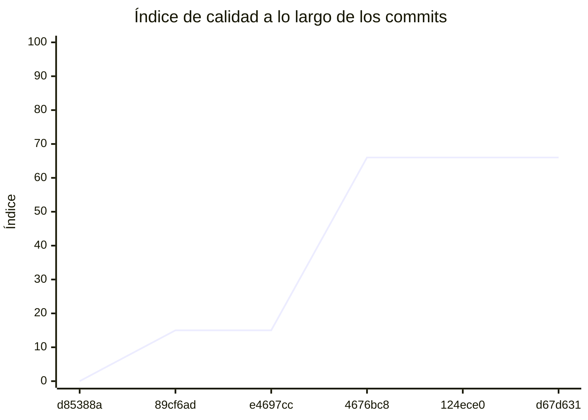

<!-- evaluacion:inicio -->
# Evaluación — Prog2-fzapata/ServicioCatalogo

> Documento **generado automáticamente** por la cátedra de Programación II (UM): RepoSense + análisis de calidad de **7 dimensiones**. **No editar a mano**: se regenera en cada evaluación.
> Rama evaluada: `main`. Análisis **heurístico** (regex + métricas) + build: es una criba para orientar la revisión, **no una nota**. La **documentación** del repositorio no se evalúa.
> Generado: 2026-11-20.

## 1. Veredicto

| Aspecto | Resultado |
|---|---|
| Índice de calidad | **78/100** |
| Tipo de repositorio | `backend` |
| Build (`mvnw verify` / `gradlew check`) | OK |
| Código (LOC) | 13,197 |
| Archivos de código | 253 |
| Clases | 281 |
| Código dentro de clases (%POO) | 64% |
| Funciones fuera de clases | 0 |
| Duplicación (puerta) | 1.8% |
| Duplicación lógica | 1.9% |
| Duplicación de boilerplate | 14.4% |
| Cobertura | 99% |
| Tope duro aplicado a D1 | `POO_BAJO` → D1 ≤ 60 |

> Este informe **describe** lo que el análisis midió con los criterios ya establecidos de la materia. No es una nota.

## 2. Semáforo de aprobación

Criterios de la cátedra (`CRITERIOS-CALIDAD.md`): **Aprobar** se juega con el perfil `estandar`; **destacar**, con el `exigente` (meta de excelencia).

| Semáforo | Resultado |
|---|---|
| Aprobar (`estandar`) | **cumple** — 8/11 |
| Destacar (`exigente`) | **no cumple** — 5/11 |

**Para destacar, falta cumplir:** SOLID; POO; Duplicación

## 3. Autoría (RepoSense)

| Autor | Commits | Código (LOC) | Tests (LOC) | Docs (LOC) | Días activos | % del código |
|---|---:|---:|---:|---:|---:|---:|
| Franco Zapata | 56 | 5,033 | 11,106 | 704 | 24 | 100% |

> _El LOC de autoría lo calcula RepoSense sobre el historial y puede diferir del LOC de código del análisis (que mira el estado de `main`)._

## 4. Dimensiones evaluadas

Cada dimensión indica **qué mide**, **por qué importa** y **tu resultado**. Cuando el puntaje queda por debajo de la referencia, se agregan preguntas para **investigar la causa** (no hay recetas).

| Dimensión | Peso | Puntaje |
|:--|--:|--:|
| **D1** Diseño OO, SOLID y patrones (20%) | 20% | 4 |
| **D2** Arquitectura hexagonal — backend (15%) | 15% | 100 |
| **D3** Frontend KMP: MVVM y buenas prácticas (10%) | 10% | N/A |
| **D4** Integración y contrato (10%) | 10% | 90 |
| **D5** Seguridad y robustez (10%) | 10% | 100 |
| **D6** Pruebas y cobertura (20%) | 20% | 100 |
| **D7** Proceso y entrega (15%) | 15% | 100 |

### D1. Diseño OO, SOLID y patrones (20%)

- **Qué mide:** Métricas orientadas a objetos (clases, métodos, campos, cohesión, acoplamiento, herencia) y proxies de SOLID, más patrones de diseño.
- **Por qué importa:** El eje de la materia es el buen uso de la POO y su arquitectura: un diseño con clases claras y poco acopladas es más fácil de entender, probar y cambiar.
- **Tu resultado:** **4/100**
- **Para investigar la causa:**
    - ¿Se pensó el modelo de clases antes de codificar o se agrupó después?
    - ¿Qué clases concentran muchas responsabilidades a la vez?
    - ¿Los colaboradores llegan como parámetros o se crean por dentro?

### D2. Arquitectura hexagonal — backend (15%)

- **Qué mide:** Separación en capas (dominio, puertos de entrada/salida, adaptadores) y dirección de las dependencias del backend.
- **Por qué importa:** Aislar el dominio de la infraestructura permite cambiar la base de datos, el framework o el transporte sin tocar las reglas de negocio.
- **Tu resultado:** **100/100**

### D4. Integración y contrato (10%)

- **Qué mide:** Cumplimiento del contrato de integración de la cátedra (formato de errores, paginación, autenticación, endpoints esperados).
- **Por qué importa:** Los servicios deben poder integrarse entre sí y con la app sin sorpresas; el contrato es lo que hacen cumplir las pruebas de integración.
- **Tu resultado:** **90/100**

### D5. Seguridad y robustez (10%)

- **Qué mide:** Credenciales embebidas, consultas SQL por concatenación, y presencia de config de entorno; aislamiento de secretos.
- **Por qué importa:** Un secreto en el repositorio o una consulta construida por concatenación son riesgos concretos, no hipotéticos.
- **Tu resultado:** **100/100**

### D6. Pruebas y cobertura (20%)

- **Qué mide:** Cantidad y resultado de pruebas y cobertura de línea (JaCoCo/Kover, Surefire/Failsafe) cuando hay build.
- **Por qué importa:** Las pruebas son la red de seguridad para refactorizar e integrar; la cobertura acota las zonas sin verificar.
- **Tu resultado:** **100/100**

### D7. Proceso y entrega (15%)

- **Qué mide:** Artefactos verificables de proceso/entrega: `compose`, `.env.example`, CI (`.github/workflows/`), `CODEOWNERS` y wrapper de build (`mvnw`/`gradlew`). **No** puntúa documentación.
- **Por qué importa:** Un proyecto que compila, se levanta y se valida solo es más fácil de revisar y de integrar en equipo.
- **Tu resultado:** **100/100**

## 5. Señales detectadas

El análisis encontró las siguientes señales, con el archivo y la línea donde se originan cuando están disponibles:

**Archivos con más señales**

| Archivo | Señales |
|---|---:|
| `src/main/java/ar/edu/um/prog2/fzapata/catalogo/catalogo/infrastructure/client/dto/CatedraSnapshotResponse.java` | 7 |
| `src/main/java/ar/edu/um/prog2/fzapata/catalogo/catalogo/application/usecases/SynchronizeCatalogUseCaseImpl.java` | 5 |
| `src/main/java/ar/edu/um/prog2/fzapata/catalogo/catalogo/infrastructure/redis/CatedraSyncSourceAdapter.java` | 4 |
| `src/main/java/ar/edu/um/prog2/fzapata/catalogo/shared/config/CatedraContractProperties.java` | 3 |
| `src/main/java/ar/edu/um/prog2/fzapata/catalogo/shared/web/ProblemDetailsFactory.java` | 3 |
| `src/main/java/ar/edu/um/prog2/fzapata/catalogo/shared/web/GlobalExceptionHandler.java` | 3 |
| `src/main/java/ar/edu/um/prog2/fzapata/catalogo/catalogo/infrastructure/logging/SyncOutcomeLogger.java` | 3 |
| `src/main/java/ar/edu/um/prog2/fzapata/catalogo/catalogo/infrastructure/client/CatedraApiClientAdapter.java` | 3 |
| `src/main/java/ar/edu/um/prog2/fzapata/catalogo/catalogo/infrastructure/web/mapper/ProfessionalQueryMapper.java` | 3 |
| `src/test/java/ar/edu/um/prog2/fzapata/catalogo/usuario/infrastructure/persistence/mapper/UserMapperTest.java` | 3 |

**DIP/concretos** (54)
- clase 'CatalogService' muy acoplada (CBO=18) — `src/main/java/ar/edu/um/prog2/fzapata/catalogo/catalogo/application/service/CatalogService.java:30`
- clase 'ApplyCatalogEventUseCaseImpl' muy acoplada (CBO=14) — `src/main/java/ar/edu/um/prog2/fzapata/catalogo/catalogo/application/usecases/ApplyCatalogEventUseCaseImpl.java:23`
- clase 'ApplyCatalogIncrementUseCaseImpl' muy acoplada (CBO=19) — `src/main/java/ar/edu/um/prog2/fzapata/catalogo/catalogo/application/usecases/ApplyCatalogIncrementUseCaseImpl.java:20`
- clase 'ApplyCatalogSnapshotUseCaseImpl' muy acoplada (CBO=15) — `src/main/java/ar/edu/um/prog2/fzapata/catalogo/catalogo/application/usecases/ApplyCatalogSnapshotUseCaseImpl.java:20`
- clase 'ClearSyncErrorUseCaseImpl' muy acoplada (CBO=9) — `src/main/java/ar/edu/um/prog2/fzapata/catalogo/catalogo/application/usecases/ClearSyncErrorUseCaseImpl.java:17`
- clase 'GetProfessionalUseCaseImpl' muy acoplada (CBO=11) — `src/main/java/ar/edu/um/prog2/fzapata/catalogo/catalogo/application/usecases/GetProfessionalUseCaseImpl.java:20`
- clase 'RecordSyncFailureUseCaseImpl' muy acoplada (CBO=16) — `src/main/java/ar/edu/um/prog2/fzapata/catalogo/catalogo/application/usecases/RecordSyncFailureUseCaseImpl.java:18`
- clase 'SearchProfessionalsUseCaseImpl' muy acoplada (CBO=21) — `src/main/java/ar/edu/um/prog2/fzapata/catalogo/catalogo/application/usecases/SearchProfessionalsUseCaseImpl.java:27`
- clase 'SynchronizeCatalogUseCaseImpl' muy acoplada (CBO=44) — `src/main/java/ar/edu/um/prog2/fzapata/catalogo/catalogo/application/usecases/SynchronizeCatalogUseCaseImpl.java:36`
- clase 'SynchronizeCatalogUseCaseImpl' instancia 3 concretos (CBO=44) — `src/main/java/ar/edu/um/prog2/fzapata/catalogo/catalogo/application/usecases/SynchronizeCatalogUseCaseImpl.java:36`
- clase 'SyncState' muy acoplada (CBO=8) — `src/main/java/ar/edu/um/prog2/fzapata/catalogo/catalogo/domain/model/SyncState.java:15`
- clase 'ProfessionalCategoryRepository' muy acoplada (CBO=9) — `src/main/java/ar/edu/um/prog2/fzapata/catalogo/catalogo/domain/ports/out/ProfessionalCategoryRepository.java:13`
- clase 'CatedraApiClientAdapter' muy acoplada (CBO=24) — `src/main/java/ar/edu/um/prog2/fzapata/catalogo/catalogo/infrastructure/client/CatedraApiClientAdapter.java:21`
- clase 'CatedraApiClientAdapter' instancia 5 concretos (CBO=24) — `src/main/java/ar/edu/um/prog2/fzapata/catalogo/catalogo/infrastructure/client/CatedraApiClientAdapter.java:21`
- clase 'CatedraEntityMapper' muy acoplada (CBO=9) — `src/main/java/ar/edu/um/prog2/fzapata/catalogo/catalogo/infrastructure/client/CatedraEntityMapper.java:16`
- clase 'CatalogEventListener' muy acoplada (CBO=9) — `src/main/java/ar/edu/um/prog2/fzapata/catalogo/catalogo/infrastructure/kafka/CatalogEventListener.java:15`
- clase 'CatalogEventMapper' muy acoplada (CBO=8) — `src/main/java/ar/edu/um/prog2/fzapata/catalogo/catalogo/infrastructure/kafka/CatalogEventMapper.java:11`
- clase 'CatalogEventMapper' instancia 5 concretos (CBO=8) — `src/main/java/ar/edu/um/prog2/fzapata/catalogo/catalogo/infrastructure/kafka/CatalogEventMapper.java:11`
- clase 'CatalogKafkaErrorHandlerConfiguration' muy acoplada (CBO=10) — `src/main/java/ar/edu/um/prog2/fzapata/catalogo/catalogo/infrastructure/kafka/CatalogKafkaErrorHandlerConfiguration.java:11`
- clase 'SyncOutcomeLogger' muy acoplada (CBO=11) — `src/main/java/ar/edu/um/prog2/fzapata/catalogo/catalogo/infrastructure/logging/SyncOutcomeLogger.java:15`
- clase 'JpaCatalogRepositoryAdapter' muy acoplada (CBO=19) — `src/main/java/ar/edu/um/prog2/fzapata/catalogo/catalogo/infrastructure/persistence/adapter/JpaCatalogRepositoryAdapter.java:27`
- clase 'JpaProfessionalCategoryRepositoryAdapter' muy acoplada (CBO=23) — `src/main/java/ar/edu/um/prog2/fzapata/catalogo/catalogo/infrastructure/persistence/adapter/JpaProfessionalCategoryRepositoryAdapter.java:27`
- clase 'JpaProfessionalRepositoryAdapter' muy acoplada (CBO=26) — `src/main/java/ar/edu/um/prog2/fzapata/catalogo/catalogo/infrastructure/persistence/adapter/JpaProfessionalRepositoryAdapter.java:27`
- clase 'ProfessionalSpecifications' muy acoplada (CBO=23) — `src/main/java/ar/edu/um/prog2/fzapata/catalogo/catalogo/infrastructure/persistence/specification/ProfessionalSpecifications.java:12`
- clase 'CatedraSyncSourceAdapter' muy acoplada (CBO=40) — `src/main/java/ar/edu/um/prog2/fzapata/catalogo/catalogo/infrastructure/redis/CatedraSyncSourceAdapter.java:35`
- clase 'RedisSyncMapper' muy acoplada (CBO=9) — `src/main/java/ar/edu/um/prog2/fzapata/catalogo/catalogo/infrastructure/redis/RedisSyncMapper.java:17`
- clase 'CatalogVersionCheckScheduler' muy acoplada (CBO=12) — `src/main/java/ar/edu/um/prog2/fzapata/catalogo/catalogo/infrastructure/scheduling/CatalogVersionCheckScheduler.java:24`
- clase 'ProfessionalCategoryController' muy acoplada (CBO=11) — `src/main/java/ar/edu/um/prog2/fzapata/catalogo/catalogo/infrastructure/web/controller/ProfessionalCategoryController.java:29`
- clase 'ProfessionalController' muy acoplada (CBO=18) — `src/main/java/ar/edu/um/prog2/fzapata/catalogo/catalogo/infrastructure/web/controller/ProfessionalController.java:31`
- clase 'CatalogExceptionHandler' muy acoplada (CBO=16) — `src/main/java/ar/edu/um/prog2/fzapata/catalogo/catalogo/infrastructure/web/handler/CatalogExceptionHandler.java:25`
- clase 'CategoryQueryMapper' muy acoplada (CBO=20) — `src/main/java/ar/edu/um/prog2/fzapata/catalogo/catalogo/infrastructure/web/mapper/CategoryQueryMapper.java:21`
- clase 'CategoryQueryMapper' instancia 4 concretos (CBO=20) — `src/main/java/ar/edu/um/prog2/fzapata/catalogo/catalogo/infrastructure/web/mapper/CategoryQueryMapper.java:21`
- clase 'ProfessionalQueryMapper' muy acoplada (CBO=22) — `src/main/java/ar/edu/um/prog2/fzapata/catalogo/catalogo/infrastructure/web/mapper/ProfessionalQueryMapper.java:21`
- clase 'ProfessionalQueryMapper' instancia 5 concretos (CBO=22) — `src/main/java/ar/edu/um/prog2/fzapata/catalogo/catalogo/infrastructure/web/mapper/ProfessionalQueryMapper.java:21`
- clase 'CatedraClientConfiguration' muy acoplada (CBO=21) — `src/main/java/ar/edu/um/prog2/fzapata/catalogo/shared/config/CatedraClientConfiguration.java:15`
- clase 'CatedraContractProperties' muy acoplada (CBO=10) — `src/main/java/ar/edu/um/prog2/fzapata/catalogo/shared/config/CatedraContractProperties.java:15`
- clase 'Argon2Properties' muy acoplada (CBO=9) — `src/main/java/ar/edu/um/prog2/fzapata/catalogo/shared/security/Argon2Properties.java:11`
- clase 'JwtConfiguration' muy acoplada (CBO=19) — `src/main/java/ar/edu/um/prog2/fzapata/catalogo/shared/security/JwtConfiguration.java:23`
- clase 'JwtConfiguration' instancia 5 concretos (CBO=19) — `src/main/java/ar/edu/um/prog2/fzapata/catalogo/shared/security/JwtConfiguration.java:23`
- clase 'OpenApiConfiguration' muy acoplada (CBO=18) — `src/main/java/ar/edu/um/prog2/fzapata/catalogo/shared/security/OpenApiConfiguration.java:16`
- clase 'OpenApiConfiguration' instancia 3 concretos (CBO=18) — `src/main/java/ar/edu/um/prog2/fzapata/catalogo/shared/security/OpenApiConfiguration.java:16`
- clase 'ProblemDetailsSecurityHandler' muy acoplada (CBO=20) — `src/main/java/ar/edu/um/prog2/fzapata/catalogo/shared/security/ProblemDetailsSecurityHandler.java:26`
- clase 'SecurityConfiguration' muy acoplada (CBO=35) — `src/main/java/ar/edu/um/prog2/fzapata/catalogo/shared/security/SecurityConfiguration.java:22`
- clase 'GlobalExceptionHandler' muy acoplada (CBO=26) — `src/main/java/ar/edu/um/prog2/fzapata/catalogo/shared/web/GlobalExceptionHandler.java:30`
- clase 'PaginationHeaders' muy acoplada (CBO=11) — `src/main/java/ar/edu/um/prog2/fzapata/catalogo/shared/web/PaginationHeaders.java:12`
- clase 'ProblemDetailsFactory' muy acoplada (CBO=23) — `src/main/java/ar/edu/um/prog2/fzapata/catalogo/shared/web/ProblemDetailsFactory.java:12`
- clase 'ProblemDetailsFactory' instancia 7 concretos (CBO=23) — `src/main/java/ar/edu/um/prog2/fzapata/catalogo/shared/web/ProblemDetailsFactory.java:12`
- clase 'AuthenticateUserUseCaseImpl' muy acoplada (CBO=10) — `src/main/java/ar/edu/um/prog2/fzapata/catalogo/usuario/application/usecases/AuthenticateUserUseCaseImpl.java:18`
- clase 'RegisterUserUseCaseImpl' muy acoplada (CBO=12) — `src/main/java/ar/edu/um/prog2/fzapata/catalogo/usuario/application/usecases/RegisterUserUseCaseImpl.java:18`
- clase 'UpdateAccountUseCaseImpl' muy acoplada (CBO=9) — `src/main/java/ar/edu/um/prog2/fzapata/catalogo/usuario/application/usecases/UpdateAccountUseCaseImpl.java:17`
- clase 'JwtTokenIssuer' muy acoplada (CBO=17) — `src/main/java/ar/edu/um/prog2/fzapata/catalogo/usuario/infrastructure/security/JwtTokenIssuer.java:22`
- clase 'AccountController' muy acoplada (CBO=16) — `src/main/java/ar/edu/um/prog2/fzapata/catalogo/usuario/infrastructure/web/controller/AccountController.java:24`
- clase 'AuthenticationController' muy acoplada (CBO=15) — `src/main/java/ar/edu/um/prog2/fzapata/catalogo/usuario/infrastructure/web/controller/AuthenticationController.java:18`
- clase 'UserExceptionHandler' muy acoplada (CBO=29) — `src/main/java/ar/edu/um/prog2/fzapata/catalogo/usuario/infrastructure/web/handler/UserExceptionHandler.java:29`

**OCP/type-switch** (3)
- clase 'RecordSyncFailureUseCaseImpl' con 1 type-checks — `src/main/java/ar/edu/um/prog2/fzapata/catalogo/catalogo/application/usecases/RecordSyncFailureUseCaseImpl.java:18`
- clase 'GlobalExceptionHandler' con 2 type-checks — `src/main/java/ar/edu/um/prog2/fzapata/catalogo/shared/web/GlobalExceptionHandler.java:30`
- clase 'UserExceptionHandler' con 1 type-checks — `src/main/java/ar/edu/um/prog2/fzapata/catalogo/usuario/infrastructure/web/handler/UserExceptionHandler.java:29`

**SRP/responsabilidad** (24)
- clase 'CatalogService' con baja cohesión (7%) — `src/main/java/ar/edu/um/prog2/fzapata/catalogo/catalogo/application/service/CatalogService.java:30`
- clase 'SynchronizeCatalogUseCaseImpl' grande (LOC=134, métodos=14, campos=9) — `src/main/java/ar/edu/um/prog2/fzapata/catalogo/catalogo/application/usecases/SynchronizeCatalogUseCaseImpl.java:36`
- clase 'SynchronizeCatalogUseCaseImpl' con baja cohesión (3%) — `src/main/java/ar/edu/um/prog2/fzapata/catalogo/catalogo/application/usecases/SynchronizeCatalogUseCaseImpl.java:36`
- método 'SynchronizeCatalogUseCaseImpl.synchronizeFor' con complejidad 6 — `src/main/java/ar/edu/um/prog2/fzapata/catalogo/catalogo/application/usecases/SynchronizeCatalogUseCaseImpl.java:74`
- clase 'CatedraApiClientAdapter' con baja cohesión (20%) — `src/main/java/ar/edu/um/prog2/fzapata/catalogo/catalogo/infrastructure/client/CatedraApiClientAdapter.java:21`
- método 'CatedraSnapshotResponse.CatedraSnapshotResponse' con 5 parámetros — `src/main/java/ar/edu/um/prog2/fzapata/catalogo/catalogo/infrastructure/client/dto/CatedraSnapshotResponse.java:10`
- método 'CatedraSnapshotResponse.CategoryResponse' con 6 parámetros — `src/main/java/ar/edu/um/prog2/fzapata/catalogo/catalogo/infrastructure/client/dto/CatedraSnapshotResponse.java:17`
- método 'CategoryResponse.CategoryResponse' con 6 parámetros — `src/main/java/ar/edu/um/prog2/fzapata/catalogo/catalogo/infrastructure/client/dto/CatedraSnapshotResponse.java:17`
- método 'CatedraSnapshotResponse.ProfessionalResponse' con 7 parámetros — `src/main/java/ar/edu/um/prog2/fzapata/catalogo/catalogo/infrastructure/client/dto/CatedraSnapshotResponse.java:21`
- método 'ProfessionalResponse.ProfessionalResponse' con 7 parámetros — `src/main/java/ar/edu/um/prog2/fzapata/catalogo/catalogo/infrastructure/client/dto/CatedraSnapshotResponse.java:21`
- método 'CatedraSnapshotResponse.WeeklyScheduleResponse' con 9 parámetros — `src/main/java/ar/edu/um/prog2/fzapata/catalogo/catalogo/infrastructure/client/dto/CatedraSnapshotResponse.java:25`
- método 'WeeklyScheduleResponse.WeeklyScheduleResponse' con 9 parámetros — `src/main/java/ar/edu/um/prog2/fzapata/catalogo/catalogo/infrastructure/client/dto/CatedraSnapshotResponse.java:25`
- método 'SyncOutcomeLogger.Origin' con 5 parámetros — `src/main/java/ar/edu/um/prog2/fzapata/catalogo/catalogo/infrastructure/logging/SyncOutcomeLogger.java:19`
- método 'Origin.Origin' con 5 parámetros — `src/main/java/ar/edu/um/prog2/fzapata/catalogo/catalogo/infrastructure/logging/SyncOutcomeLogger.java:19`
- clase 'JpaCatalogRepositoryAdapter' con baja cohesión (10%) — `src/main/java/ar/edu/um/prog2/fzapata/catalogo/catalogo/infrastructure/persistence/adapter/JpaCatalogRepositoryAdapter.java:27`
- clase 'CatedraSyncSourceAdapter' grande (LOC=76, métodos=10, campos=5) — `src/main/java/ar/edu/um/prog2/fzapata/catalogo/catalogo/infrastructure/redis/CatedraSyncSourceAdapter.java:35`
- clase 'CatedraSyncSourceAdapter' con baja cohesión (29%) — `src/main/java/ar/edu/um/prog2/fzapata/catalogo/catalogo/infrastructure/redis/CatedraSyncSourceAdapter.java:35`
- método 'CatedraSyncSourceAdapter.readByIds' con 5 parámetros — `src/main/java/ar/edu/um/prog2/fzapata/catalogo/catalogo/infrastructure/redis/CatedraSyncSourceAdapter.java:101`
- clase 'ProfessionalQueryMapper' con baja cohesión (33%) — `src/main/java/ar/edu/um/prog2/fzapata/catalogo/catalogo/infrastructure/web/mapper/ProfessionalQueryMapper.java:21`
- método 'CatedraContractProperties.RedisKeys' con 5 parámetros — `src/main/java/ar/edu/um/prog2/fzapata/catalogo/shared/config/CatedraContractProperties.java:23`
- método 'RedisKeys.RedisKeys' con 5 parámetros — `src/main/java/ar/edu/um/prog2/fzapata/catalogo/shared/config/CatedraContractProperties.java:23`
- método 'GlobalExceptionHandler.handleExceptionInternal' con 5 parámetros — `src/main/java/ar/edu/um/prog2/fzapata/catalogo/shared/web/GlobalExceptionHandler.java:65`
- método 'ProblemDetailsFactory.standardFor' con complejidad 7 — `src/main/java/ar/edu/um/prog2/fzapata/catalogo/shared/web/ProblemDetailsFactory.java:59`
- clase 'UserService' con baja cohesión (0%) — `src/main/java/ar/edu/um/prog2/fzapata/catalogo/usuario/application/service/UserService.java:16`

**?** (3)
- clase 'CatedraAuthenticationException' con herencia profunda (DIT=2) — `src/main/java/ar/edu/um/prog2/fzapata/catalogo/catalogo/application/exception/CatedraAuthenticationException.java:4`
- clase 'CatedraResponseException' con herencia profunda (DIT=2) — `src/main/java/ar/edu/um/prog2/fzapata/catalogo/catalogo/application/exception/CatedraResponseException.java:4`
- clase 'CatedraUnavailableException' con herencia profunda (DIT=2) — `src/main/java/ar/edu/um/prog2/fzapata/catalogo/catalogo/application/exception/CatedraUnavailableException.java:4`

**duplicación** (6)
- duplicación lógica: 1.8% · boilerplate: 14.4%
- bloque de 8 líneas repetido 2 veces en src/test/java/ar/edu/um/prog2/fzapata/catalogo/catalogo/infrastructure/web/controller/ProfessionalCategoryControllerTest.java:108, src/test/java/ar/edu/um/prog2/fzapata/catalogo/catalogo/infrastructure/web/controller/ProfessionalControllerTest.java:138 — `src/test/java/ar/edu/um/prog2/fzapata/catalogo/catalogo/infrastructure/web/controller/ProfessionalCategoryControllerTest.java:108`
- bloque de 8 líneas repetido 2 veces en src/test/java/ar/edu/um/prog2/fzapata/catalogo/usuario/infrastructure/persistence/adapter/JpaUserRepositoryAdapterTest.java:66, src/test/java/ar/edu/um/prog2/fzapata/catalogo/usuario/infrastructure/web/controller/AccountManagementControllerTest.java:71 — `src/test/java/ar/edu/um/prog2/fzapata/catalogo/usuario/infrastructure/persistence/adapter/JpaUserRepositoryAdapterTest.java:66`
- bloque de 8 líneas repetido 2 veces en src/test/java/ar/edu/um/prog2/fzapata/catalogo/usuario/infrastructure/persistence/mapper/UserMapperTest.java:22, src/test/java/ar/edu/um/prog2/fzapata/catalogo/usuario/infrastructure/web/controller/AccountManagementControllerTest.java:68 — `src/test/java/ar/edu/um/prog2/fzapata/catalogo/usuario/infrastructure/persistence/mapper/UserMapperTest.java:22`
- bloque de 8 líneas repetido 2 veces en src/test/java/ar/edu/um/prog2/fzapata/catalogo/usuario/infrastructure/persistence/mapper/UserMapperTest.java:23, src/test/java/ar/edu/um/prog2/fzapata/catalogo/usuario/infrastructure/web/controller/AccountManagementControllerTest.java:69 — `src/test/java/ar/edu/um/prog2/fzapata/catalogo/usuario/infrastructure/persistence/mapper/UserMapperTest.java:23`
- bloque de 8 líneas repetido 2 veces en src/test/java/ar/edu/um/prog2/fzapata/catalogo/usuario/infrastructure/persistence/mapper/UserMapperTest.java:24, src/test/java/ar/edu/um/prog2/fzapata/catalogo/usuario/infrastructure/web/controller/AccountManagementControllerTest.java:70 — `src/test/java/ar/edu/um/prog2/fzapata/catalogo/usuario/infrastructure/persistence/mapper/UserMapperTest.java:24`

## 6. Evolución por commit

Métricas calculadas sobre el estado de `main` en **cada commit** (6 commits con trabajo), del primero al último. La calidad usa el perfil `exigente`; el aporte de código lo mide RepoSense. El índice puede **bajar** al crecer el proyecto: se acumulan señales.

| # | Fecha | Commit | Autor | LOC | Índice | %POO | Duplic. | Sueltas |
|---|---|---|---|---:|---:|---:|---:|---:|
| 1 | 2026-09-07 | `d85388a` | Franco Zapata | 0 | 0 | 0% | 0.0% | 0 |
| 2 | 2026-09-10 | `89cf6ad` | Ing. Daniel Quinteros | 0 | 15 | 0% | 0.0% | 0 |
| 3 | 2026-10-13 | `e4697cc` | Franco Zapata | 0 | 15 | 0% | 0.0% | 0 |
| 4 | 2026-11-02 | `4676bc8` | Franco Zapata | 11,816 | 66 | 63% | 2.0% | 1 |
| 5 | 2026-11-17 | `124ece0` | Franco Zapata | 12,938 | 66 | 64% | 1.9% | 0 |
| 6 | 2026-11-18 | `d67d631` | Franco Zapata | 13,197 | 66 | 64% | 1.8% | 0 |

---
_Informe generado por la cátedra. Las dimensiones y umbrales corresponden a `calidad.py` (perfil `exigente`); el semáforo, a `CRITERIOS-CALIDAD.md`. La documentación del repositorio no se evalúa. Ante dudas, revisá el archivo señalado._
<!-- evaluacion:fin -->
