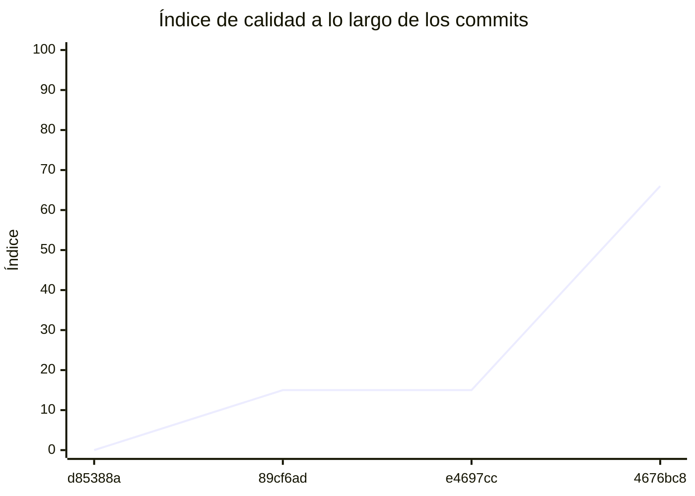

<!-- evaluacion:inicio -->
# Evaluación — Prog2-fzapata/ServicioCatalogo

> Documento **generado automáticamente** por la cátedra de Programación II (UM): RepoSense + análisis de calidad de **7 dimensiones**. **No editar a mano**: se regenera en cada evaluación.
> Rama evaluada: `main`. Análisis **heurístico** (regex + métricas) + build: es una criba para orientar la revisión, **no una nota**. La **documentación** del repositorio no se evalúa.
> Generado: 2026-11-11.

## 1. Veredicto

| Aspecto | Resultado |
|---|---|
| Índice de calidad | **77/100** |
| Tipo de repositorio | `backend` |
| Build (`mvnw verify` / `gradlew check`) | OK |
| Código (LOC) | 11,816 |
| Archivos de código | 241 |
| Clases | 253 |
| Código dentro de clases (%POO) | 73% |
| Funciones fuera de clases | 1 |
| Duplicación (puerta) | 2.0% |
| Duplicación lógica | 2.2% |
| Duplicación de boilerplate | 15.8% |
| Cobertura | 99% |
| Tope duro aplicado a D1 | `POO_BAJO` → D1 ≤ 60 |

> Este informe **describe** lo que el análisis midió con los criterios ya establecidos de la materia. No es una nota.

## 2. Semáforo de aprobación

Criterios de la cátedra (`CRITERIOS-CALIDAD.md`): **Aprobar** se juega con el perfil `estandar`; **destacar**, con el `exigente` (meta de excelencia).

| Semáforo | Resultado |
|---|---|
| Aprobar (`estandar`) | **no cumple** — 7/11 |
| Destacar (`exigente`) | **no cumple** — 5/11 |

**Para aprobar, falta cumplir:** SOLID

**Para destacar, falta cumplir:** SOLID; POO; Duplicación

## 3. Autoría (RepoSense)

| Autor | Commits | Código (LOC) | Tests (LOC) | Docs (LOC) | Días activos | % del código |
|---|---:|---:|---:|---:|---:|---:|
| Franco Zapata | 38 | 4,800 | 9,682 | 609 | 18 | 100% |

> _El LOC de autoría lo calcula RepoSense sobre el historial y puede diferir del LOC de código del análisis (que mira el estado de `main`)._

## 4. Dimensiones evaluadas

Cada dimensión indica **qué mide**, **por qué importa** y **tu resultado**. Cuando el puntaje queda por debajo de la referencia, se agregan preguntas para **investigar la causa** (no hay recetas).

| Dimensión | Peso | Puntaje |
|:--|--:|--:|
| **D1** Diseño OO, SOLID y patrones (20%) | 20% | 1 |
| **D2** Arquitectura hexagonal — backend (15%) | 15% | 100 |
| **D3** Frontend KMP: MVVM y buenas prácticas (10%) | 10% | N/A |
| **D4** Integración y contrato (10%) | 10% | 90 |
| **D5** Seguridad y robustez (10%) | 10% | 100 |
| **D6** Pruebas y cobertura (20%) | 20% | 100 |
| **D7** Proceso y entrega (15%) | 15% | 100 |

### D1. Diseño OO, SOLID y patrones (20%)

- **Qué mide:** Métricas orientadas a objetos (clases, métodos, campos, cohesión, acoplamiento, herencia) y proxies de SOLID, más patrones de diseño.
- **Por qué importa:** El eje de la materia es el buen uso de la POO y su arquitectura: un diseño con clases claras y poco acopladas es más fácil de entender, probar y cambiar.
- **Tu resultado:** **1/100**
- **Para investigar la causa:**
    - ¿Se pensó el modelo de clases antes de codificar o se agrupó después?
    - ¿Qué clases concentran muchas responsabilidades a la vez?
    - ¿Los colaboradores llegan como parámetros o se crean por dentro?

### D2. Arquitectura hexagonal — backend (15%)

- **Qué mide:** Separación en capas (dominio, puertos de entrada/salida, adaptadores) y dirección de las dependencias del backend.
- **Por qué importa:** Aislar el dominio de la infraestructura permite cambiar la base de datos, el framework o el transporte sin tocar las reglas de negocio.
- **Tu resultado:** **100/100**

### D4. Integración y contrato (10%)

- **Qué mide:** Cumplimiento del contrato de integración de la cátedra (formato de errores, paginación, autenticación, endpoints esperados).
- **Por qué importa:** Los servicios deben poder integrarse entre sí y con la app sin sorpresas; el contrato es lo que hacen cumplir las pruebas de integración.
- **Tu resultado:** **90/100**

### D5. Seguridad y robustez (10%)

- **Qué mide:** Credenciales embebidas, consultas SQL por concatenación, y presencia de config de entorno; aislamiento de secretos.
- **Por qué importa:** Un secreto en el repositorio o una consulta construida por concatenación son riesgos concretos, no hipotéticos.
- **Tu resultado:** **100/100**

### D6. Pruebas y cobertura (20%)

- **Qué mide:** Cantidad y resultado de pruebas y cobertura de línea (JaCoCo/Kover, Surefire/Failsafe) cuando hay build.
- **Por qué importa:** Las pruebas son la red de seguridad para refactorizar e integrar; la cobertura acota las zonas sin verificar.
- **Tu resultado:** **100/100**

### D7. Proceso y entrega (15%)

- **Qué mide:** Artefactos verificables de proceso/entrega: `compose`, `.env.example`, CI (`.github/workflows/`), `CODEOWNERS` y wrapper de build (`mvnw`/`gradlew`). **No** puntúa documentación.
- **Por qué importa:** Un proyecto que compila, se levanta y se valida solo es más fácil de revisar y de integrar en equipo.
- **Tu resultado:** **100/100**

## 5. Señales detectadas

El análisis encontró las siguientes señales (archivo, sin número de línea a propósito):

**DIP/concretos** (143)
- clase 'JwtTokenIssuer' muy acoplada (CBO=17) — `src/main/java/ar/edu/um/prog2/fzapata/catalogo/usuario/infrastructure/security/JwtTokenIssuer.java`
- clase 'AuthenticationController' muy acoplada (CBO=15) — `src/main/java/ar/edu/um/prog2/fzapata/catalogo/usuario/infrastructure/web/controller/AuthenticationController.java`
- clase 'AccountController' muy acoplada (CBO=16) — `src/main/java/ar/edu/um/prog2/fzapata/catalogo/usuario/infrastructure/web/controller/AccountController.java`
- clase 'UserExceptionHandler' muy acoplada (CBO=18) — `src/main/java/ar/edu/um/prog2/fzapata/catalogo/usuario/infrastructure/web/handler/UserExceptionHandler.java`
- clase 'RegisterUserUseCaseImpl' muy acoplada (CBO=12) — `src/main/java/ar/edu/um/prog2/fzapata/catalogo/usuario/application/usecases/RegisterUserUseCaseImpl.java`
- clase 'AuthenticateUserUseCaseImpl' muy acoplada (CBO=10) — `src/main/java/ar/edu/um/prog2/fzapata/catalogo/usuario/application/usecases/AuthenticateUserUseCaseImpl.java`
- clase 'UpdateAccountUseCaseImpl' muy acoplada (CBO=9) — `src/main/java/ar/edu/um/prog2/fzapata/catalogo/usuario/application/usecases/UpdateAccountUseCaseImpl.java`
- clase 'Argon2Properties' muy acoplada (CBO=9) — `src/main/java/ar/edu/um/prog2/fzapata/catalogo/shared/security/Argon2Properties.java`
- clase 'JwtConfiguration' muy acoplada (CBO=17) — `src/main/java/ar/edu/um/prog2/fzapata/catalogo/shared/security/JwtConfiguration.java`
- clase 'JwtConfiguration' instancia 4 concretos (CBO=17) — `src/main/java/ar/edu/um/prog2/fzapata/catalogo/shared/security/JwtConfiguration.java`
- clase 'OpenApiConfiguration' muy acoplada (CBO=14) — `src/main/java/ar/edu/um/prog2/fzapata/catalogo/shared/security/OpenApiConfiguration.java`
- clase 'OpenApiConfiguration' instancia 3 concretos (CBO=14) — `src/main/java/ar/edu/um/prog2/fzapata/catalogo/shared/security/OpenApiConfiguration.java`
- clase 'SecurityConfiguration' muy acoplada (CBO=21) — `src/main/java/ar/edu/um/prog2/fzapata/catalogo/shared/security/SecurityConfiguration.java`
- clase 'ProblemDetailsSecurityHandler' muy acoplada (CBO=19) — `src/main/java/ar/edu/um/prog2/fzapata/catalogo/shared/security/ProblemDetailsSecurityHandler.java`
- clase 'CatedraClientConfiguration' muy acoplada (CBO=13) — `src/main/java/ar/edu/um/prog2/fzapata/catalogo/shared/config/CatedraClientConfiguration.java`
- clase 'CatedraContractProperties' muy acoplada (CBO=10) — `src/main/java/ar/edu/um/prog2/fzapata/catalogo/shared/config/CatedraContractProperties.java`
- clase 'PaginationHeaders' muy acoplada (CBO=8) — `src/main/java/ar/edu/um/prog2/fzapata/catalogo/shared/web/PaginationHeaders.java`
- clase 'ProblemDetailsFactory' muy acoplada (CBO=22) — `src/main/java/ar/edu/um/prog2/fzapata/catalogo/shared/web/ProblemDetailsFactory.java`
- clase 'ProblemDetailsFactory' instancia 7 concretos (CBO=22) — `src/main/java/ar/edu/um/prog2/fzapata/catalogo/shared/web/ProblemDetailsFactory.java`
- clase 'GlobalExceptionHandler' muy acoplada (CBO=20) — `src/main/java/ar/edu/um/prog2/fzapata/catalogo/shared/web/GlobalExceptionHandler.java`
- clase 'RedisSyncMapper' muy acoplada (CBO=9) — `src/main/java/ar/edu/um/prog2/fzapata/catalogo/catalogo/infrastructure/redis/RedisSyncMapper.java`
- clase 'CatedraSyncSourceAdapter' muy acoplada (CBO=29) — `src/main/java/ar/edu/um/prog2/fzapata/catalogo/catalogo/infrastructure/redis/CatedraSyncSourceAdapter.java`
- clase 'CatalogEventListener' muy acoplada (CBO=10) — `src/main/java/ar/edu/um/prog2/fzapata/catalogo/catalogo/infrastructure/kafka/CatalogEventListener.java`
- clase 'CatalogEventMapper' muy acoplada (CBO=8) — `src/main/java/ar/edu/um/prog2/fzapata/catalogo/catalogo/infrastructure/kafka/CatalogEventMapper.java`
- clase 'CatalogEventMapper' instancia 5 concretos (CBO=8) — `src/main/java/ar/edu/um/prog2/fzapata/catalogo/catalogo/infrastructure/kafka/CatalogEventMapper.java`
- clase 'CatalogKafkaErrorHandlerConfiguration' muy acoplada (CBO=9) — `src/main/java/ar/edu/um/prog2/fzapata/catalogo/catalogo/infrastructure/kafka/CatalogKafkaErrorHandlerConfiguration.java`
- clase 'CatalogVersionCheckScheduler' muy acoplada (CBO=12) — `src/main/java/ar/edu/um/prog2/fzapata/catalogo/catalogo/infrastructure/scheduling/CatalogVersionCheckScheduler.java`
- clase 'ProfessionalSpecifications' muy acoplada (CBO=11) — `src/main/java/ar/edu/um/prog2/fzapata/catalogo/catalogo/infrastructure/persistence/specification/ProfessionalSpecifications.java`
- clase 'JpaCatalogRepositoryAdapter' muy acoplada (CBO=19) — `src/main/java/ar/edu/um/prog2/fzapata/catalogo/catalogo/infrastructure/persistence/adapter/JpaCatalogRepositoryAdapter.java`
- clase 'JpaProfessionalRepositoryAdapter' muy acoplada (CBO=25) — `src/main/java/ar/edu/um/prog2/fzapata/catalogo/catalogo/infrastructure/persistence/adapter/JpaProfessionalRepositoryAdapter.java`
- clase 'JpaProfessionalCategoryRepositoryAdapter' muy acoplada (CBO=23) — `src/main/java/ar/edu/um/prog2/fzapata/catalogo/catalogo/infrastructure/persistence/adapter/JpaProfessionalCategoryRepositoryAdapter.java`
- clase 'CatedraApiClientAdapter' muy acoplada (CBO=19) — `src/main/java/ar/edu/um/prog2/fzapata/catalogo/catalogo/infrastructure/client/CatedraApiClientAdapter.java`
- clase 'CatedraApiClientAdapter' instancia 5 concretos (CBO=19) — `src/main/java/ar/edu/um/prog2/fzapata/catalogo/catalogo/infrastructure/client/CatedraApiClientAdapter.java`
- clase 'CatedraEntityMapper' muy acoplada (CBO=9) — `src/main/java/ar/edu/um/prog2/fzapata/catalogo/catalogo/infrastructure/client/CatedraEntityMapper.java`
- clase 'ProfessionalCategoryController' muy acoplada (CBO=11) — `src/main/java/ar/edu/um/prog2/fzapata/catalogo/catalogo/infrastructure/web/controller/ProfessionalCategoryController.java`
- clase 'ProfessionalController' muy acoplada (CBO=15) — `src/main/java/ar/edu/um/prog2/fzapata/catalogo/catalogo/infrastructure/web/controller/ProfessionalController.java`
- clase 'CatalogExceptionHandler' muy acoplada (CBO=16) — `src/main/java/ar/edu/um/prog2/fzapata/catalogo/catalogo/infrastructure/web/handler/CatalogExceptionHandler.java`
- clase 'ProfessionalQueryMapper' muy acoplada (CBO=18) — `src/main/java/ar/edu/um/prog2/fzapata/catalogo/catalogo/infrastructure/web/mapper/ProfessionalQueryMapper.java`
- clase 'ProfessionalQueryMapper' instancia 5 concretos (CBO=18) — `src/main/java/ar/edu/um/prog2/fzapata/catalogo/catalogo/infrastructure/web/mapper/ProfessionalQueryMapper.java`
- clase 'CategoryQueryMapper' muy acoplada (CBO=16) — `src/main/java/ar/edu/um/prog2/fzapata/catalogo/catalogo/infrastructure/web/mapper/CategoryQueryMapper.java`
- clase 'CategoryQueryMapper' instancia 4 concretos (CBO=16) — `src/main/java/ar/edu/um/prog2/fzapata/catalogo/catalogo/infrastructure/web/mapper/CategoryQueryMapper.java`
- clase 'CatalogService' muy acoplada (CBO=18) — `src/main/java/ar/edu/um/prog2/fzapata/catalogo/catalogo/application/service/CatalogService.java`
- clase 'RecordSyncFailureUseCaseImpl' muy acoplada (CBO=18) — `src/main/java/ar/edu/um/prog2/fzapata/catalogo/catalogo/application/usecases/RecordSyncFailureUseCaseImpl.java`
- clase 'ClearSyncErrorUseCaseImpl' muy acoplada (CBO=10) — `src/main/java/ar/edu/um/prog2/fzapata/catalogo/catalogo/application/usecases/ClearSyncErrorUseCaseImpl.java`
- clase 'GetProfessionalUseCaseImpl' muy acoplada (CBO=10) — `src/main/java/ar/edu/um/prog2/fzapata/catalogo/catalogo/application/usecases/GetProfessionalUseCaseImpl.java`
- clase 'ApplyCatalogIncrementUseCaseImpl' muy acoplada (CBO=16) — `src/main/java/ar/edu/um/prog2/fzapata/catalogo/catalogo/application/usecases/ApplyCatalogIncrementUseCaseImpl.java`
- clase 'SearchProfessionalsUseCaseImpl' muy acoplada (CBO=14) — `src/main/java/ar/edu/um/prog2/fzapata/catalogo/catalogo/application/usecases/SearchProfessionalsUseCaseImpl.java`
- clase 'ApplyCatalogSnapshotUseCaseImpl' muy acoplada (CBO=14) — `src/main/java/ar/edu/um/prog2/fzapata/catalogo/catalogo/application/usecases/ApplyCatalogSnapshotUseCaseImpl.java`
- clase 'ApplyCatalogEventUseCaseImpl' muy acoplada (CBO=14) — `src/main/java/ar/edu/um/prog2/fzapata/catalogo/catalogo/application/usecases/ApplyCatalogEventUseCaseImpl.java`
- clase 'SynchronizeCatalogUseCaseImpl' muy acoplada (CBO=37) — `src/main/java/ar/edu/um/prog2/fzapata/catalogo/catalogo/application/usecases/SynchronizeCatalogUseCaseImpl.java`
- clase 'SynchronizeCatalogUseCaseImpl' instancia 3 concretos (CBO=37) — `src/main/java/ar/edu/um/prog2/fzapata/catalogo/catalogo/application/usecases/SynchronizeCatalogUseCaseImpl.java`
- clase 'ProfessionalCategoryRepository' muy acoplada (CBO=9) — `src/main/java/ar/edu/um/prog2/fzapata/catalogo/catalogo/domain/ports/out/ProfessionalCategoryRepository.java`
- clase 'ApiDocsDefaultProfileTest' muy acoplada (CBO=8) — `src/test/java/ar/edu/um/prog2/fzapata/catalogo/ApiDocsDefaultProfileTest.java`
- clase 'JwtTokenIssuerTest' muy acoplada (CBO=25) — `src/test/java/ar/edu/um/prog2/fzapata/catalogo/usuario/infrastructure/security/JwtTokenIssuerTest.java`
- clase 'JwtTokenIssuerTest' instancia 5 concretos (CBO=25) — `src/test/java/ar/edu/um/prog2/fzapata/catalogo/usuario/infrastructure/security/JwtTokenIssuerTest.java`
- clase 'UserMapperTest' muy acoplada (CBO=8) — `src/test/java/ar/edu/um/prog2/fzapata/catalogo/usuario/infrastructure/persistence/mapper/UserMapperTest.java`
- clase 'JpaUserRepositoryAdapterTest' muy acoplada (CBO=14) — `src/test/java/ar/edu/um/prog2/fzapata/catalogo/usuario/infrastructure/persistence/adapter/JpaUserRepositoryAdapterTest.java`
- clase 'AuthenticationControllerTest' muy acoplada (CBO=12) — `src/test/java/ar/edu/um/prog2/fzapata/catalogo/usuario/infrastructure/web/controller/AuthenticationControllerTest.java`
- clase 'AccountRegistrationIntegrationTest' muy acoplada (CBO=25) — `src/test/java/ar/edu/um/prog2/fzapata/catalogo/usuario/infrastructure/web/controller/AccountRegistrationIntegrationTest.java`
- clase 'AuthenticationIntegrationTest' muy acoplada (CBO=46) — `src/test/java/ar/edu/um/prog2/fzapata/catalogo/usuario/infrastructure/web/controller/AuthenticationIntegrationTest.java`
- clase 'AuthenticationIntegrationTest' instancia 3 concretos (CBO=46) — `src/test/java/ar/edu/um/prog2/fzapata/catalogo/usuario/infrastructure/web/controller/AuthenticationIntegrationTest.java`
- clase 'AccountManagementControllerTest' muy acoplada (CBO=20) — `src/test/java/ar/edu/um/prog2/fzapata/catalogo/usuario/infrastructure/web/controller/AccountManagementControllerTest.java`
- clase 'AccountControllerTest' muy acoplada (CBO=30) — `src/test/java/ar/edu/um/prog2/fzapata/catalogo/usuario/infrastructure/web/controller/AccountControllerTest.java`
- clase 'AccountControllerTest' instancia 7 concretos (CBO=30) — `src/test/java/ar/edu/um/prog2/fzapata/catalogo/usuario/infrastructure/web/controller/AccountControllerTest.java`
- clase 'UserServiceTest' muy acoplada (CBO=8) — `src/test/java/ar/edu/um/prog2/fzapata/catalogo/usuario/application/service/UserServiceTest.java`
- clase 'UpdateAccountUseCaseImplTest' muy acoplada (CBO=14) — `src/test/java/ar/edu/um/prog2/fzapata/catalogo/usuario/application/usecases/UpdateAccountUseCaseImplTest.java`
- clase 'AuthenticateUserUseCaseImplTest' muy acoplada (CBO=10) — `src/test/java/ar/edu/um/prog2/fzapata/catalogo/usuario/application/usecases/AuthenticateUserUseCaseImplTest.java`
- clase 'RegisterUserUseCaseImplTest' muy acoplada (CBO=17) — `src/test/java/ar/edu/um/prog2/fzapata/catalogo/usuario/application/usecases/RegisterUserUseCaseImplTest.java`
- clase 'SecurityRejectionTest' muy acoplada (CBO=34) — `src/test/java/ar/edu/um/prog2/fzapata/catalogo/shared/security/SecurityRejectionTest.java`
- clase 'CatedraContractPropertiesTest' muy acoplada (CBO=8) — `src/test/java/ar/edu/um/prog2/fzapata/catalogo/shared/config/CatedraContractPropertiesTest.java`
- clase 'TuningParametersDefaultsTest' muy acoplada (CBO=15) — `src/test/java/ar/edu/um/prog2/fzapata/catalogo/shared/config/TuningParametersDefaultsTest.java`
- clase 'CatedraClientConfigurationTest' muy acoplada (CBO=15) — `src/test/java/ar/edu/um/prog2/fzapata/catalogo/shared/config/CatedraClientConfigurationTest.java`
- clase 'CatedraClientConfigurationTest' instancia 3 concretos (CBO=15) — `src/test/java/ar/edu/um/prog2/fzapata/catalogo/shared/config/CatedraClientConfigurationTest.java`
- clase 'PaginationHeadersTest' muy acoplada (CBO=10) — `src/test/java/ar/edu/um/prog2/fzapata/catalogo/shared/web/PaginationHeadersTest.java`
- clase 'CatalogFixtures' muy acoplada (CBO=13) — `src/test/java/ar/edu/um/prog2/fzapata/catalogo/catalogo/CatalogFixtures.java`
- clase 'CatedraSyncSourceAdapterTest' muy acoplada (CBO=35) — `src/test/java/ar/edu/um/prog2/fzapata/catalogo/catalogo/infrastructure/redis/CatedraSyncSourceAdapterTest.java`
- clase 'CatedraSyncSourceAdapterTest' instancia 10 concretos (CBO=35) — `src/test/java/ar/edu/um/prog2/fzapata/catalogo/catalogo/infrastructure/redis/CatedraSyncSourceAdapterTest.java`
- clase 'CatedraSyncSourceIntegrationTest' muy acoplada (CBO=20) — `src/test/java/ar/edu/um/prog2/fzapata/catalogo/catalogo/infrastructure/redis/CatedraSyncSourceIntegrationTest.java`
- clase 'RedisSyncMapperTest' muy acoplada (CBO=8) — `src/test/java/ar/edu/um/prog2/fzapata/catalogo/catalogo/infrastructure/redis/RedisSyncMapperTest.java`
- clase 'RedisSyncMapperTest' instancia 11 concretos (CBO=8) — `src/test/java/ar/edu/um/prog2/fzapata/catalogo/catalogo/infrastructure/redis/RedisSyncMapperTest.java`
- clase 'SyncOutcomeLoggerTest' muy acoplada (CBO=9) — `src/test/java/ar/edu/um/prog2/fzapata/catalogo/catalogo/infrastructure/logging/SyncOutcomeLoggerTest.java`
- clase 'SyncOutcomeLoggerTest' instancia 4 concretos (CBO=9) — `src/test/java/ar/edu/um/prog2/fzapata/catalogo/catalogo/infrastructure/logging/SyncOutcomeLoggerTest.java`
- clase 'CatalogEventListenerTest' muy acoplada (CBO=15) — `src/test/java/ar/edu/um/prog2/fzapata/catalogo/catalogo/infrastructure/kafka/CatalogEventListenerTest.java`
- clase 'CatalogEventListenerTest' instancia 7 concretos (CBO=15) — `src/test/java/ar/edu/um/prog2/fzapata/catalogo/catalogo/infrastructure/kafka/CatalogEventListenerTest.java`
- clase 'CatalogEventListenerIntegrationTest' muy acoplada (CBO=39) — `src/test/java/ar/edu/um/prog2/fzapata/catalogo/catalogo/infrastructure/kafka/CatalogEventListenerIntegrationTest.java`
- clase 'CatalogEventListenerIntegrationTest' instancia 9 concretos (CBO=39) — `src/test/java/ar/edu/um/prog2/fzapata/catalogo/catalogo/infrastructure/kafka/CatalogEventListenerIntegrationTest.java`
- clase 'CatalogVersionCheckSchedulerTest' muy acoplada (CBO=11) — `src/test/java/ar/edu/um/prog2/fzapata/catalogo/catalogo/infrastructure/scheduling/CatalogVersionCheckSchedulerTest.java`
- clase 'CatalogVersionCheckSchedulerTest' instancia 5 concretos (CBO=11) — `src/test/java/ar/edu/um/prog2/fzapata/catalogo/catalogo/infrastructure/scheduling/CatalogVersionCheckSchedulerTest.java`
- clase 'CatalogVersionCheckSchedulerIntegrationTest' muy acoplada (CBO=22) — `src/test/java/ar/edu/um/prog2/fzapata/catalogo/catalogo/infrastructure/scheduling/CatalogVersionCheckSchedulerIntegrationTest.java`
- clase 'CatalogVersionCheckSchedulerIntegrationTest' instancia 7 concretos (CBO=22) — `src/test/java/ar/edu/um/prog2/fzapata/catalogo/catalogo/infrastructure/scheduling/CatalogVersionCheckSchedulerIntegrationTest.java`
- clase 'CatalogSchemaTest' muy acoplada (CBO=25) — `src/test/java/ar/edu/um/prog2/fzapata/catalogo/catalogo/infrastructure/persistence/CatalogSchemaTest.java`
- clase 'JpaProfessionalRepositoryAdapterSortTest' muy acoplada (CBO=11) — `src/test/java/ar/edu/um/prog2/fzapata/catalogo/catalogo/infrastructure/persistence/adapter/JpaProfessionalRepositoryAdapterSortTest.java`
- clase 'JpaProfessionalRepositoryAdapterSortTest' instancia 4 concretos (CBO=11) — `src/test/java/ar/edu/um/prog2/fzapata/catalogo/catalogo/infrastructure/persistence/adapter/JpaProfessionalRepositoryAdapterSortTest.java`
- clase 'JpaProcessedEventRepositoryAdapterTest' muy acoplada (CBO=17) — `src/test/java/ar/edu/um/prog2/fzapata/catalogo/catalogo/infrastructure/persistence/adapter/JpaProcessedEventRepositoryAdapterTest.java`
- clase 'JpaProfessionalRepositoryAdapterTest' muy acoplada (CBO=42) — `src/test/java/ar/edu/um/prog2/fzapata/catalogo/catalogo/infrastructure/persistence/adapter/JpaProfessionalRepositoryAdapterTest.java`
- clase 'JpaProfessionalRepositoryAdapterTest' instancia 16 concretos (CBO=42) — `src/test/java/ar/edu/um/prog2/fzapata/catalogo/catalogo/infrastructure/persistence/adapter/JpaProfessionalRepositoryAdapterTest.java`
- clase 'JpaSyncStateRepositoryAdapterTest' muy acoplada (CBO=12) — `src/test/java/ar/edu/um/prog2/fzapata/catalogo/catalogo/infrastructure/persistence/adapter/JpaSyncStateRepositoryAdapterTest.java`
- clase 'JpaCatalogRepositoryAdapterTest' muy acoplada (CBO=32) — `src/test/java/ar/edu/um/prog2/fzapata/catalogo/catalogo/infrastructure/persistence/adapter/JpaCatalogRepositoryAdapterTest.java`
- clase 'JpaProfessionalCategoryRepositoryAdapterTest' muy acoplada (CBO=17) — `src/test/java/ar/edu/um/prog2/fzapata/catalogo/catalogo/infrastructure/persistence/adapter/JpaProfessionalCategoryRepositoryAdapterTest.java`
- clase 'JpaProfessionalCategoryRepositoryAdapterTest' instancia 16 concretos (CBO=17) — `src/test/java/ar/edu/um/prog2/fzapata/catalogo/catalogo/infrastructure/persistence/adapter/JpaProfessionalCategoryRepositoryAdapterTest.java`
- clase 'JpaProfessionalCategoryRepositoryAdapterSortTest' muy acoplada (CBO=9) — `src/test/java/ar/edu/um/prog2/fzapata/catalogo/catalogo/infrastructure/persistence/adapter/JpaProfessionalCategoryRepositoryAdapterSortTest.java`
- clase 'JpaProfessionalCategoryRepositoryAdapterSortTest' instancia 3 concretos (CBO=9) — `src/test/java/ar/edu/um/prog2/fzapata/catalogo/catalogo/infrastructure/persistence/adapter/JpaProfessionalCategoryRepositoryAdapterSortTest.java`
- clase 'CatedraApiClientAdapterTest' muy acoplada (CBO=39) — `src/test/java/ar/edu/um/prog2/fzapata/catalogo/catalogo/infrastructure/client/CatedraApiClientAdapterTest.java`
- clase 'CatedraApiClientAdapterTest' instancia 4 concretos (CBO=39) — `src/test/java/ar/edu/um/prog2/fzapata/catalogo/catalogo/infrastructure/client/CatedraApiClientAdapterTest.java`
- clase 'CatedraSnapshotMapperTest' muy acoplada (CBO=14) — `src/test/java/ar/edu/um/prog2/fzapata/catalogo/catalogo/infrastructure/client/CatedraSnapshotMapperTest.java`
- clase 'CatedraSnapshotMapperTest' instancia 9 concretos (CBO=14) — `src/test/java/ar/edu/um/prog2/fzapata/catalogo/catalogo/infrastructure/client/CatedraSnapshotMapperTest.java`
- clase 'ProfessionalCategoryControllerTest' muy acoplada (CBO=22) — `src/test/java/ar/edu/um/prog2/fzapata/catalogo/catalogo/infrastructure/web/controller/ProfessionalCategoryControllerTest.java`
- clase 'ProfessionalCategoryControllerTest' instancia 9 concretos (CBO=22) — `src/test/java/ar/edu/um/prog2/fzapata/catalogo/catalogo/infrastructure/web/controller/ProfessionalCategoryControllerTest.java`
- clase 'ProfessionalDetailIntegrationTest' muy acoplada (CBO=30) — `src/test/java/ar/edu/um/prog2/fzapata/catalogo/catalogo/infrastructure/web/controller/ProfessionalDetailIntegrationTest.java`
- clase 'ProfessionalSearchIntegrationTest' muy acoplada (CBO=39) — `src/test/java/ar/edu/um/prog2/fzapata/catalogo/catalogo/infrastructure/web/controller/ProfessionalSearchIntegrationTest.java`
- clase 'CategorySearchIntegrationTest' muy acoplada (CBO=21) — `src/test/java/ar/edu/um/prog2/fzapata/catalogo/catalogo/infrastructure/web/controller/CategorySearchIntegrationTest.java`
- clase 'SyncStatusControllerTest' muy acoplada (CBO=20) — `src/test/java/ar/edu/um/prog2/fzapata/catalogo/catalogo/infrastructure/web/controller/SyncStatusControllerTest.java`
- clase 'ProfessionalControllerTest' muy acoplada (CBO=36) — `src/test/java/ar/edu/um/prog2/fzapata/catalogo/catalogo/infrastructure/web/controller/ProfessionalControllerTest.java`
- clase 'ProfessionalControllerTest' instancia 15 concretos (CBO=36) — `src/test/java/ar/edu/um/prog2/fzapata/catalogo/catalogo/infrastructure/web/controller/ProfessionalControllerTest.java`
- clase 'SyncStatusIntegrationTest' muy acoplada (CBO=25) — `src/test/java/ar/edu/um/prog2/fzapata/catalogo/catalogo/infrastructure/web/controller/SyncStatusIntegrationTest.java`
- clase 'SyncStatusDtoMapperTest' muy acoplada (CBO=9) — `src/test/java/ar/edu/um/prog2/fzapata/catalogo/catalogo/infrastructure/web/mapper/SyncStatusDtoMapperTest.java`
- clase 'ProfessionalDtoMapperTest' muy acoplada (CBO=13) — `src/test/java/ar/edu/um/prog2/fzapata/catalogo/catalogo/infrastructure/web/mapper/ProfessionalDtoMapperTest.java`
- clase 'ProfessionalDtoMapperTest' instancia 4 concretos (CBO=13) — `src/test/java/ar/edu/um/prog2/fzapata/catalogo/catalogo/infrastructure/web/mapper/ProfessionalDtoMapperTest.java`
- clase 'ProfessionalQueryMapperTest' muy acoplada (CBO=18) — `src/test/java/ar/edu/um/prog2/fzapata/catalogo/catalogo/infrastructure/web/mapper/ProfessionalQueryMapperTest.java`
- clase 'ProfessionalQueryMapperTest' instancia 7 concretos (CBO=18) — `src/test/java/ar/edu/um/prog2/fzapata/catalogo/catalogo/infrastructure/web/mapper/ProfessionalQueryMapperTest.java`
- clase 'CategoryQueryMapperTest' muy acoplada (CBO=15) — `src/test/java/ar/edu/um/prog2/fzapata/catalogo/catalogo/infrastructure/web/mapper/CategoryQueryMapperTest.java`
- clase 'CategoryQueryMapperTest' instancia 6 concretos (CBO=15) — `src/test/java/ar/edu/um/prog2/fzapata/catalogo/catalogo/infrastructure/web/mapper/CategoryQueryMapperTest.java`
- clase 'CatalogServiceTest' muy acoplada (CBO=21) — `src/test/java/ar/edu/um/prog2/fzapata/catalogo/catalogo/application/service/CatalogServiceTest.java`
- clase 'CatalogServiceTest' instancia 5 concretos (CBO=21) — `src/test/java/ar/edu/um/prog2/fzapata/catalogo/catalogo/application/service/CatalogServiceTest.java`
- clase 'GetProfessionalUseCaseImplTest' muy acoplada (CBO=13) — `src/test/java/ar/edu/um/prog2/fzapata/catalogo/catalogo/application/usecases/GetProfessionalUseCaseImplTest.java`
- clase 'ClearSyncErrorUseCaseImplTest' muy acoplada (CBO=17) — `src/test/java/ar/edu/um/prog2/fzapata/catalogo/catalogo/application/usecases/ClearSyncErrorUseCaseImplTest.java`
- clase 'ApplyCatalogSnapshotUseCaseImplTest' muy acoplada (CBO=20) — `src/test/java/ar/edu/um/prog2/fzapata/catalogo/catalogo/application/usecases/ApplyCatalogSnapshotUseCaseImplTest.java`
- clase 'ApplyCatalogSnapshotUseCaseImplTest' instancia 4 concretos (CBO=20) — `src/test/java/ar/edu/um/prog2/fzapata/catalogo/catalogo/application/usecases/ApplyCatalogSnapshotUseCaseImplTest.java`
- clase 'SearchProfessionalsUseCaseImplTest' muy acoplada (CBO=17) — `src/test/java/ar/edu/um/prog2/fzapata/catalogo/catalogo/application/usecases/SearchProfessionalsUseCaseImplTest.java`
- clase 'SearchProfessionalsUseCaseImplTest' instancia 3 concretos (CBO=17) — `src/test/java/ar/edu/um/prog2/fzapata/catalogo/catalogo/application/usecases/SearchProfessionalsUseCaseImplTest.java`
- clase 'ApplyCatalogIncrementUseCaseImplTest' muy acoplada (CBO=20) — `src/test/java/ar/edu/um/prog2/fzapata/catalogo/catalogo/application/usecases/ApplyCatalogIncrementUseCaseImplTest.java`
- clase 'ApplyCatalogIncrementUseCaseImplTest' instancia 3 concretos (CBO=20) — `src/test/java/ar/edu/um/prog2/fzapata/catalogo/catalogo/application/usecases/ApplyCatalogIncrementUseCaseImplTest.java`
- clase 'RecordSyncFailureUseCaseImplTest' muy acoplada (CBO=22) — `src/test/java/ar/edu/um/prog2/fzapata/catalogo/catalogo/application/usecases/RecordSyncFailureUseCaseImplTest.java`
- clase 'RecordSyncFailureUseCaseImplTest' instancia 7 concretos (CBO=22) — `src/test/java/ar/edu/um/prog2/fzapata/catalogo/catalogo/application/usecases/RecordSyncFailureUseCaseImplTest.java`
- clase 'SynchronizeCatalogIntegrationTest' muy acoplada (CBO=34) — `src/test/java/ar/edu/um/prog2/fzapata/catalogo/catalogo/application/usecases/SynchronizeCatalogIntegrationTest.java`
- clase 'SynchronizeCatalogIntegrationTest' instancia 8 concretos (CBO=34) — `src/test/java/ar/edu/um/prog2/fzapata/catalogo/catalogo/application/usecases/SynchronizeCatalogIntegrationTest.java`
- clase 'ApplyCatalogEventUseCaseImplTest' muy acoplada (CBO=22) — `src/test/java/ar/edu/um/prog2/fzapata/catalogo/catalogo/application/usecases/ApplyCatalogEventUseCaseImplTest.java`
- clase 'ApplyCatalogEventUseCaseImplTest' instancia 8 concretos (CBO=22) — `src/test/java/ar/edu/um/prog2/fzapata/catalogo/catalogo/application/usecases/ApplyCatalogEventUseCaseImplTest.java`
- clase 'SynchronizeCatalogIncrementalIntegrationTest' muy acoplada (CBO=45) — `src/test/java/ar/edu/um/prog2/fzapata/catalogo/catalogo/application/usecases/SynchronizeCatalogIncrementalIntegrationTest.java`
- clase 'SynchronizeCatalogIncrementalIntegrationTest' instancia 8 concretos (CBO=45) — `src/test/java/ar/edu/um/prog2/fzapata/catalogo/catalogo/application/usecases/SynchronizeCatalogIncrementalIntegrationTest.java`
- clase 'SynchronizeCatalogUseCaseImplTest' muy acoplada (CBO=43) — `src/test/java/ar/edu/um/prog2/fzapata/catalogo/catalogo/application/usecases/SynchronizeCatalogUseCaseImplTest.java`
- clase 'SynchronizeCatalogUseCaseImplTest' instancia 38 concretos (CBO=43) — `src/test/java/ar/edu/um/prog2/fzapata/catalogo/catalogo/application/usecases/SynchronizeCatalogUseCaseImplTest.java`
- clase 'WeeklyScheduleTest' muy acoplada (CBO=8) — `src/test/java/ar/edu/um/prog2/fzapata/catalogo/catalogo/domain/model/WeeklyScheduleTest.java`

**SRP/responsabilidad** (101)
- clase 'UserEntity' grande (LOC=23, métodos=0, campos=12) — `src/main/java/ar/edu/um/prog2/fzapata/catalogo/usuario/infrastructure/persistence/entity/UserEntity.java`
- clase 'UserEntity' sin métodos (12 campos): solo datos — `src/main/java/ar/edu/um/prog2/fzapata/catalogo/usuario/infrastructure/persistence/entity/UserEntity.java`
- clase 'UserRegistrationRequest' grande (LOC=24, métodos=0, campos=8) — `src/main/java/ar/edu/um/prog2/fzapata/catalogo/usuario/infrastructure/web/dto/UserRegistrationRequest.java`
- clase 'UserRegistrationRequest' sin métodos (8 campos): solo datos — `src/main/java/ar/edu/um/prog2/fzapata/catalogo/usuario/infrastructure/web/dto/UserRegistrationRequest.java`
- clase 'AccountResponse' grande (LOC=10, métodos=0, campos=8) — `src/main/java/ar/edu/um/prog2/fzapata/catalogo/usuario/infrastructure/web/dto/AccountResponse.java`
- clase 'AccountResponse' sin métodos (8 campos): solo datos — `src/main/java/ar/edu/um/prog2/fzapata/catalogo/usuario/infrastructure/web/dto/AccountResponse.java`
- clase 'AccountUpdateRequest' sin métodos (5 campos): solo datos — `src/main/java/ar/edu/um/prog2/fzapata/catalogo/usuario/infrastructure/web/dto/AccountUpdateRequest.java`
- clase 'LoginRequest' sin métodos (3 campos): solo datos — `src/main/java/ar/edu/um/prog2/fzapata/catalogo/usuario/infrastructure/web/dto/LoginRequest.java`
- clase 'UserService' con baja cohesión (20%) — `src/main/java/ar/edu/um/prog2/fzapata/catalogo/usuario/application/service/UserService.java`
- clase 'User' grande (LOC=15, métodos=0, campos=12) — `src/main/java/ar/edu/um/prog2/fzapata/catalogo/usuario/domain/model/User.java`
- clase 'User' sin métodos (12 campos): solo datos — `src/main/java/ar/edu/um/prog2/fzapata/catalogo/usuario/domain/model/User.java`
- método 'ProblemDetailsFactory.standardFor' con complejidad 7 — `src/main/java/ar/edu/um/prog2/fzapata/catalogo/shared/web/ProblemDetailsFactory.java`
- clase 'CatedraSyncSourceAdapter' grande (LOC=69, métodos=10, campos=5) — `src/main/java/ar/edu/um/prog2/fzapata/catalogo/catalogo/infrastructure/redis/CatedraSyncSourceAdapter.java`
- clase 'CatedraSyncSourceAdapter' con baja cohesión (29%) — `src/main/java/ar/edu/um/prog2/fzapata/catalogo/catalogo/infrastructure/redis/CatedraSyncSourceAdapter.java`
- método 'CatedraSyncSourceAdapter.readByIds' con 5 parámetros — `src/main/java/ar/edu/um/prog2/fzapata/catalogo/catalogo/infrastructure/redis/CatedraSyncSourceAdapter.java`
- clase 'CatalogMapper' grande (LOC=76, métodos=11, campos=0) — `src/main/java/ar/edu/um/prog2/fzapata/catalogo/catalogo/infrastructure/persistence/mapper/CatalogMapper.java`
- clase 'JpaCatalogRepositoryAdapter' con baja cohesión (0%) — `src/main/java/ar/edu/um/prog2/fzapata/catalogo/catalogo/infrastructure/persistence/adapter/JpaCatalogRepositoryAdapter.java`
- clase 'SyncStateEntity' sin métodos (7 campos): solo datos — `src/main/java/ar/edu/um/prog2/fzapata/catalogo/catalogo/infrastructure/persistence/entity/SyncStateEntity.java`
- clase 'ProfessionalCategoryEntity' sin métodos (6 campos): solo datos — `src/main/java/ar/edu/um/prog2/fzapata/catalogo/catalogo/infrastructure/persistence/entity/ProfessionalCategoryEntity.java`
- clase 'ProcessedEventEntity' sin métodos (3 campos): solo datos — `src/main/java/ar/edu/um/prog2/fzapata/catalogo/catalogo/infrastructure/persistence/entity/ProcessedEventEntity.java`
- clase 'WeeklyScheduleEntity' grande (LOC=13, métodos=0, campos=9) — `src/main/java/ar/edu/um/prog2/fzapata/catalogo/catalogo/infrastructure/persistence/entity/WeeklyScheduleEntity.java`
- clase 'WeeklyScheduleEntity' sin métodos (9 campos): solo datos — `src/main/java/ar/edu/um/prog2/fzapata/catalogo/catalogo/infrastructure/persistence/entity/WeeklyScheduleEntity.java`
- clase 'ProfessionalEntity' sin métodos (7 campos): solo datos — `src/main/java/ar/edu/um/prog2/fzapata/catalogo/catalogo/infrastructure/persistence/entity/ProfessionalEntity.java`
- clase 'CatedraApiClientAdapter' con baja cohesión (20%) — `src/main/java/ar/edu/um/prog2/fzapata/catalogo/catalogo/infrastructure/client/CatedraApiClientAdapter.java`
- clase 'ProfessionalCategoryController' sin métodos (3 campos): solo datos — `src/main/java/ar/edu/um/prog2/fzapata/catalogo/catalogo/infrastructure/web/controller/ProfessionalCategoryController.java`
- clase 'WeeklyScheduleSummaryResponse' sin métodos (4 campos): solo datos — `src/main/java/ar/edu/um/prog2/fzapata/catalogo/catalogo/infrastructure/web/dto/WeeklyScheduleSummaryResponse.java`
- clase 'SyncStatusResponse' sin métodos (5 campos): solo datos — `src/main/java/ar/edu/um/prog2/fzapata/catalogo/catalogo/infrastructure/web/dto/SyncStatusResponse.java`
- clase 'ProfessionalCategoryResponse' sin métodos (4 campos): solo datos — `src/main/java/ar/edu/um/prog2/fzapata/catalogo/catalogo/infrastructure/web/dto/ProfessionalCategoryResponse.java`
- clase 'WeeklyScheduleDetailResponse' sin métodos (6 campos): solo datos — `src/main/java/ar/edu/um/prog2/fzapata/catalogo/catalogo/infrastructure/web/dto/WeeklyScheduleDetailResponse.java`
- clase 'ProfessionalDetailResponse' sin métodos (7 campos): solo datos — `src/main/java/ar/edu/um/prog2/fzapata/catalogo/catalogo/infrastructure/web/dto/ProfessionalDetailResponse.java`
- clase 'ProfessionalSummaryResponse' sin métodos (7 campos): solo datos — `src/main/java/ar/edu/um/prog2/fzapata/catalogo/catalogo/infrastructure/web/dto/ProfessionalSummaryResponse.java`
- clase 'CatalogService' con baja cohesión (17%) — `src/main/java/ar/edu/um/prog2/fzapata/catalogo/catalogo/application/service/CatalogService.java`
- clase 'GetProfessionalUseCaseImpl' con baja cohesión (33%) — `src/main/java/ar/edu/um/prog2/fzapata/catalogo/catalogo/application/usecases/GetProfessionalUseCaseImpl.java`
- clase 'SynchronizeCatalogUseCaseImpl' grande (LOC=143, métodos=15, campos=9) — `src/main/java/ar/edu/um/prog2/fzapata/catalogo/catalogo/application/usecases/SynchronizeCatalogUseCaseImpl.java`
- clase 'SynchronizeCatalogUseCaseImpl' con baja cohesión (8%) — `src/main/java/ar/edu/um/prog2/fzapata/catalogo/catalogo/application/usecases/SynchronizeCatalogUseCaseImpl.java`
- método 'SynchronizeCatalogUseCaseImpl.isPresent' de 35 líneas — `src/main/java/ar/edu/um/prog2/fzapata/catalogo/catalogo/application/usecases/SynchronizeCatalogUseCaseImpl.java`
- método 'SynchronizeCatalogUseCaseImpl.isPresent' con complejidad 7 — `src/main/java/ar/edu/um/prog2/fzapata/catalogo/catalogo/application/usecases/SynchronizeCatalogUseCaseImpl.java`
- método 'SynchronizeCatalogUseCaseImpl.synchronizeFor' con complejidad 7 — `src/main/java/ar/edu/um/prog2/fzapata/catalogo/catalogo/application/usecases/SynchronizeCatalogUseCaseImpl.java`
- clase 'SyncState' sin métodos (5 campos): solo datos — `src/main/java/ar/edu/um/prog2/fzapata/catalogo/catalogo/domain/model/SyncState.java`
- clase 'CatalogSnapshot' sin métodos (5 campos): solo datos — `src/main/java/ar/edu/um/prog2/fzapata/catalogo/catalogo/domain/model/CatalogSnapshot.java`
- clase 'WeeklySchedule' grande (LOC=15, métodos=0, campos=10) — `src/main/java/ar/edu/um/prog2/fzapata/catalogo/catalogo/domain/model/WeeklySchedule.java`
- clase 'WeeklySchedule' sin métodos (10 campos): solo datos — `src/main/java/ar/edu/um/prog2/fzapata/catalogo/catalogo/domain/model/WeeklySchedule.java`
- clase 'ProcessedEvent' sin métodos (3 campos): solo datos — `src/main/java/ar/edu/um/prog2/fzapata/catalogo/catalogo/domain/model/ProcessedEvent.java`
- clase 'CatalogIncrement' sin métodos (4 campos): solo datos — `src/main/java/ar/edu/um/prog2/fzapata/catalogo/catalogo/domain/model/CatalogIncrement.java`
- clase 'ProfessionalCategory' sin métodos (6 campos): solo datos — `src/main/java/ar/edu/um/prog2/fzapata/catalogo/catalogo/domain/model/ProfessionalCategory.java`
- clase 'Professional' sin métodos (7 campos): solo datos — `src/main/java/ar/edu/um/prog2/fzapata/catalogo/catalogo/domain/model/Professional.java`
- clase 'JpaUserRepositoryAdapterTest' grande (LOC=138, métodos=12, campos=3) — `src/test/java/ar/edu/um/prog2/fzapata/catalogo/usuario/infrastructure/persistence/adapter/JpaUserRepositoryAdapterTest.java`
- clase 'AccountRegistrationIntegrationTest' con baja cohesión (21%) — `src/test/java/ar/edu/um/prog2/fzapata/catalogo/usuario/infrastructure/web/controller/AccountRegistrationIntegrationTest.java`
- clase 'AuthenticationIntegrationTest' grande (LOC=221, métodos=33, campos=5) — `src/test/java/ar/edu/um/prog2/fzapata/catalogo/usuario/infrastructure/web/controller/AuthenticationIntegrationTest.java`
- clase 'AuthenticationIntegrationTest' con baja cohesión (10%) — `src/test/java/ar/edu/um/prog2/fzapata/catalogo/usuario/infrastructure/web/controller/AuthenticationIntegrationTest.java`
- clase 'AccountManagementControllerTest' grande (LOC=108, métodos=12, campos=3) — `src/test/java/ar/edu/um/prog2/fzapata/catalogo/usuario/infrastructure/web/controller/AccountManagementControllerTest.java`
- clase 'AccountManagementControllerTest' con baja cohesión (48%) — `src/test/java/ar/edu/um/prog2/fzapata/catalogo/usuario/infrastructure/web/controller/AccountManagementControllerTest.java`
- clase 'AccountControllerTest' grande (LOC=171, métodos=20, campos=2) — `src/test/java/ar/edu/um/prog2/fzapata/catalogo/usuario/infrastructure/web/controller/AccountControllerTest.java`
- clase 'UpdateAccountUseCaseImplTest' grande (LOC=113, métodos=14, campos=2) — `src/test/java/ar/edu/um/prog2/fzapata/catalogo/usuario/application/usecases/UpdateAccountUseCaseImplTest.java`
- clase 'AuthenticateUserUseCaseImplTest' grande (LOC=126, métodos=15, campos=4) — `src/test/java/ar/edu/um/prog2/fzapata/catalogo/usuario/application/usecases/AuthenticateUserUseCaseImplTest.java`
- método 'AuthenticateUserUseCaseImplTest.whenTheTextIsTheLoginOfOneUserAndTheEmailOfAnotherTheOneWhosePasswordMatchesEnters' con complejidad 6 — `src/test/java/ar/edu/um/prog2/fzapata/catalogo/usuario/application/usecases/AuthenticateUserUseCaseImplTest.java`
- clase 'RegisterUserUseCaseImplTest' grande (LOC=106, métodos=10, campos=3) — `src/test/java/ar/edu/um/prog2/fzapata/catalogo/usuario/application/usecases/RegisterUserUseCaseImplTest.java`
- clase 'SecurityRejectionTest' grande (LOC=82, métodos=14, campos=2) — `src/test/java/ar/edu/um/prog2/fzapata/catalogo/shared/security/SecurityRejectionTest.java`
- clase 'CatedraClientConfigurationTest' grande (LOC=69, métodos=11, campos=0) — `src/test/java/ar/edu/um/prog2/fzapata/catalogo/shared/config/CatedraClientConfigurationTest.java`
- clase 'PaginationHeadersTest' grande (LOC=63, métodos=11, campos=1) — `src/test/java/ar/edu/um/prog2/fzapata/catalogo/shared/web/PaginationHeadersTest.java`
- clase 'CatedraSyncSourceAdapterTest' grande (LOC=214, métodos=34, campos=8) — `src/test/java/ar/edu/um/prog2/fzapata/catalogo/catalogo/infrastructure/redis/CatedraSyncSourceAdapterTest.java`
- clase 'CatedraSyncSourceAdapterTest' con baja cohesión (37%) — `src/test/java/ar/edu/um/prog2/fzapata/catalogo/catalogo/infrastructure/redis/CatedraSyncSourceAdapterTest.java`
- clase 'CatedraSyncSourceIntegrationTest' con baja cohesión (14%) — `src/test/java/ar/edu/um/prog2/fzapata/catalogo/catalogo/infrastructure/redis/CatedraSyncSourceIntegrationTest.java`
- clase 'RedisSyncMapperTest' grande (LOC=65, métodos=10, campos=1) — `src/test/java/ar/edu/um/prog2/fzapata/catalogo/catalogo/infrastructure/redis/RedisSyncMapperTest.java`
- clase 'CatalogEventListenerIntegrationTest' grande (LOC=180, métodos=18, campos=8) — `src/test/java/ar/edu/um/prog2/fzapata/catalogo/catalogo/infrastructure/kafka/CatalogEventListenerIntegrationTest.java`
- clase 'CatalogEventListenerIntegrationTest' con baja cohesión (27%) — `src/test/java/ar/edu/um/prog2/fzapata/catalogo/catalogo/infrastructure/kafka/CatalogEventListenerIntegrationTest.java`
- clase 'CatalogSchemaTest' grande (LOC=127, métodos=23, campos=1) — `src/test/java/ar/edu/um/prog2/fzapata/catalogo/catalogo/infrastructure/persistence/CatalogSchemaTest.java`
- método 'CatalogSchemaTest.insertSchedule' con 6 parámetros — `src/test/java/ar/edu/um/prog2/fzapata/catalogo/catalogo/infrastructure/persistence/CatalogSchemaTest.java`
- clase 'JpaProcessedEventRepositoryAdapterTest' con baja cohesión (30%) — `src/test/java/ar/edu/um/prog2/fzapata/catalogo/catalogo/infrastructure/persistence/adapter/JpaProcessedEventRepositoryAdapterTest.java`
- clase 'JpaProfessionalRepositoryAdapterTest' grande (LOC=209, métodos=28, campos=9) — `src/test/java/ar/edu/um/prog2/fzapata/catalogo/catalogo/infrastructure/persistence/adapter/JpaProfessionalRepositoryAdapterTest.java`
- clase 'JpaProfessionalRepositoryAdapterTest' con baja cohesión (17%) — `src/test/java/ar/edu/um/prog2/fzapata/catalogo/catalogo/infrastructure/persistence/adapter/JpaProfessionalRepositoryAdapterTest.java`
- método 'JpaProfessionalRepositoryAdapterTest.person' con 5 parámetros — `src/test/java/ar/edu/um/prog2/fzapata/catalogo/catalogo/infrastructure/persistence/adapter/JpaProfessionalRepositoryAdapterTest.java`
- clase 'JpaCatalogRepositoryAdapterTest' grande (LOC=153, métodos=20, campos=5) — `src/test/java/ar/edu/um/prog2/fzapata/catalogo/catalogo/infrastructure/persistence/adapter/JpaCatalogRepositoryAdapterTest.java`
- clase 'JpaCatalogRepositoryAdapterTest' con baja cohesión (11%) — `src/test/java/ar/edu/um/prog2/fzapata/catalogo/catalogo/infrastructure/persistence/adapter/JpaCatalogRepositoryAdapterTest.java`
- clase 'JpaProfessionalCategoryRepositoryAdapterTest' grande (LOC=89, métodos=12, campos=5) — `src/test/java/ar/edu/um/prog2/fzapata/catalogo/catalogo/infrastructure/persistence/adapter/JpaProfessionalCategoryRepositoryAdapterTest.java`
- clase 'JpaProfessionalCategoryRepositoryAdapterTest' con baja cohesión (47%) — `src/test/java/ar/edu/um/prog2/fzapata/catalogo/catalogo/infrastructure/persistence/adapter/JpaProfessionalCategoryRepositoryAdapterTest.java`
- clase 'CatedraApiClientAdapterTest' grande (LOC=171, métodos=25, campos=4) — `src/test/java/ar/edu/um/prog2/fzapata/catalogo/catalogo/infrastructure/client/CatedraApiClientAdapterTest.java`
- clase 'CatedraApiClientAdapterTest' con baja cohesión (46%) — `src/test/java/ar/edu/um/prog2/fzapata/catalogo/catalogo/infrastructure/client/CatedraApiClientAdapterTest.java`
- clase 'CatedraSnapshotMapperTest' grande (LOC=55, métodos=10, campos=2) — `src/test/java/ar/edu/um/prog2/fzapata/catalogo/catalogo/infrastructure/client/CatedraSnapshotMapperTest.java`
- clase 'ProfessionalCategoryControllerTest' grande (LOC=100, métodos=12, campos=2) — `src/test/java/ar/edu/um/prog2/fzapata/catalogo/catalogo/infrastructure/web/controller/ProfessionalCategoryControllerTest.java`
- clase 'ProfessionalDetailIntegrationTest' grande (LOC=93, métodos=11, campos=6) — `src/test/java/ar/edu/um/prog2/fzapata/catalogo/catalogo/infrastructure/web/controller/ProfessionalDetailIntegrationTest.java`
- clase 'ProfessionalDetailIntegrationTest' con baja cohesión (18%) — `src/test/java/ar/edu/um/prog2/fzapata/catalogo/catalogo/infrastructure/web/controller/ProfessionalDetailIntegrationTest.java`
- método 'ProfessionalDetailIntegrationTest.scheduleOf' con 5 parámetros — `src/test/java/ar/edu/um/prog2/fzapata/catalogo/catalogo/infrastructure/web/controller/ProfessionalDetailIntegrationTest.java`
- método 'ProfessionalDetailIntegrationTest.scheduleOf' con 5 parámetros — `src/test/java/ar/edu/um/prog2/fzapata/catalogo/catalogo/infrastructure/web/controller/ProfessionalDetailIntegrationTest.java`
- clase 'ProfessionalSearchIntegrationTest' grande (LOC=134, métodos=19, campos=6) — `src/test/java/ar/edu/um/prog2/fzapata/catalogo/catalogo/infrastructure/web/controller/ProfessionalSearchIntegrationTest.java`
- clase 'ProfessionalSearchIntegrationTest' con baja cohesión (9%) — `src/test/java/ar/edu/um/prog2/fzapata/catalogo/catalogo/infrastructure/web/controller/ProfessionalSearchIntegrationTest.java`
- método 'ProfessionalSearchIntegrationTest.person' con 5 parámetros — `src/test/java/ar/edu/um/prog2/fzapata/catalogo/catalogo/infrastructure/web/controller/ProfessionalSearchIntegrationTest.java`
- método 'ProfessionalSearchIntegrationTest.scheduleOf' con 5 parámetros — `src/test/java/ar/edu/um/prog2/fzapata/catalogo/catalogo/infrastructure/web/controller/ProfessionalSearchIntegrationTest.java`
- método 'ProfessionalSearchIntegrationTest.scheduleOf' con 5 parámetros — `src/test/java/ar/edu/um/prog2/fzapata/catalogo/catalogo/infrastructure/web/controller/ProfessionalSearchIntegrationTest.java`
- clase 'CategorySearchIntegrationTest' grande (LOC=98, métodos=16, campos=4) — `src/test/java/ar/edu/um/prog2/fzapata/catalogo/catalogo/infrastructure/web/controller/CategorySearchIntegrationTest.java`
- clase 'CategorySearchIntegrationTest' con baja cohesión (18%) — `src/test/java/ar/edu/um/prog2/fzapata/catalogo/catalogo/infrastructure/web/controller/CategorySearchIntegrationTest.java`
- clase 'ProfessionalControllerTest' grande (LOC=202, métodos=21, campos=2) — `src/test/java/ar/edu/um/prog2/fzapata/catalogo/catalogo/infrastructure/web/controller/ProfessionalControllerTest.java`
- clase 'ProfessionalQueryMapperTest' grande (LOC=62, métodos=12, campos=1) — `src/test/java/ar/edu/um/prog2/fzapata/catalogo/catalogo/infrastructure/web/mapper/ProfessionalQueryMapperTest.java`
- clase 'ApplyCatalogSnapshotUseCaseImplTest' grande (LOC=79, métodos=10, campos=4) — `src/test/java/ar/edu/um/prog2/fzapata/catalogo/catalogo/application/usecases/ApplyCatalogSnapshotUseCaseImplTest.java`
- clase 'SynchronizeCatalogIntegrationTest' grande (LOC=136, métodos=17, campos=6) — `src/test/java/ar/edu/um/prog2/fzapata/catalogo/catalogo/application/usecases/SynchronizeCatalogIntegrationTest.java`
- clase 'SynchronizeCatalogIntegrationTest' con baja cohesión (24%) — `src/test/java/ar/edu/um/prog2/fzapata/catalogo/catalogo/application/usecases/SynchronizeCatalogIntegrationTest.java`
- clase 'ApplyCatalogEventUseCaseImplTest' grande (LOC=69, métodos=7, campos=8) — `src/test/java/ar/edu/um/prog2/fzapata/catalogo/catalogo/application/usecases/ApplyCatalogEventUseCaseImplTest.java`
- clase 'SynchronizeCatalogIncrementalIntegrationTest' grande (LOC=325, métodos=40, campos=11) — `src/test/java/ar/edu/um/prog2/fzapata/catalogo/catalogo/application/usecases/SynchronizeCatalogIncrementalIntegrationTest.java`
- clase 'SynchronizeCatalogIncrementalIntegrationTest' con baja cohesión (30%) — `src/test/java/ar/edu/um/prog2/fzapata/catalogo/catalogo/application/usecases/SynchronizeCatalogIncrementalIntegrationTest.java`
- clase 'SynchronizeCatalogUseCaseImplTest' grande (LOC=419, métodos=44, campos=11) — `src/test/java/ar/edu/um/prog2/fzapata/catalogo/catalogo/application/usecases/SynchronizeCatalogUseCaseImplTest.java`
- método 'SynchronizeCatalogUseCaseImplTest.secondSynchronizationWaitsForTheFirstAndThenFetchesItsOwnSnapshot' de 30 líneas — `src/test/java/ar/edu/um/prog2/fzapata/catalogo/catalogo/application/usecases/SynchronizeCatalogUseCaseImplTest.java`

**OCP/type-switch** (2)
- clase 'GlobalExceptionHandler' con 2 type-checks — `src/main/java/ar/edu/um/prog2/fzapata/catalogo/shared/web/GlobalExceptionHandler.java`
- clase 'RecordSyncFailureUseCaseImpl' con 1 type-checks — `src/main/java/ar/edu/um/prog2/fzapata/catalogo/catalogo/application/usecases/RecordSyncFailureUseCaseImpl.java`

**?** (2)
- clase 'CatedraUnavailableException' con herencia profunda (DIT=2) — `src/main/java/ar/edu/um/prog2/fzapata/catalogo/catalogo/application/exception/CatedraUnavailableException.java`
- clase 'CatedraResponseException' con herencia profunda (DIT=2) — `src/main/java/ar/edu/um/prog2/fzapata/catalogo/catalogo/application/exception/CatedraResponseException.java`

**POO** (1)
- función 'CatedraAuthenticationException' fuera de una clase — `src/main/java/ar/edu/um/prog2/fzapata/catalogo/catalogo/application/exception/CatedraAuthenticationException.java`

**duplicación** (6)
- duplicación lógica: 2.0% · boilerplate: 15.8%
- bloque de 8 líneas repetido 2 veces en src/test/java/ar/edu/um/prog2/fzapata/catalogo/catalogo/infrastructure/web/controller/ProfessionalCategoryControllerTest.java:108, src/test/java/ar/edu/um/prog2/fzapata/catalogo/catalogo/infrastructure/web/controller/ProfessionalControllerTest.java:136 — `src/test/java/ar/edu/um/prog2/fzapata/catalogo/catalogo/infrastructure/web/controller/ProfessionalCategoryControllerTest.java`
- bloque de 8 líneas repetido 2 veces en src/test/java/ar/edu/um/prog2/fzapata/catalogo/usuario/infrastructure/persistence/adapter/JpaUserRepositoryAdapterTest.java:66, src/test/java/ar/edu/um/prog2/fzapata/catalogo/usuario/infrastructure/web/controller/AccountManagementControllerTest.java:71 — `src/test/java/ar/edu/um/prog2/fzapata/catalogo/usuario/infrastructure/persistence/adapter/JpaUserRepositoryAdapterTest.java`
- bloque de 8 líneas repetido 2 veces en src/test/java/ar/edu/um/prog2/fzapata/catalogo/usuario/infrastructure/persistence/mapper/UserMapperTest.java:22, src/test/java/ar/edu/um/prog2/fzapata/catalogo/usuario/infrastructure/web/controller/AccountManagementControllerTest.java:68 — `src/test/java/ar/edu/um/prog2/fzapata/catalogo/usuario/infrastructure/persistence/mapper/UserMapperTest.java`
- bloque de 8 líneas repetido 2 veces en src/test/java/ar/edu/um/prog2/fzapata/catalogo/usuario/infrastructure/persistence/mapper/UserMapperTest.java:23, src/test/java/ar/edu/um/prog2/fzapata/catalogo/usuario/infrastructure/web/controller/AccountManagementControllerTest.java:69 — `src/test/java/ar/edu/um/prog2/fzapata/catalogo/usuario/infrastructure/persistence/mapper/UserMapperTest.java`
- bloque de 8 líneas repetido 2 veces en src/test/java/ar/edu/um/prog2/fzapata/catalogo/usuario/infrastructure/persistence/mapper/UserMapperTest.java:24, src/test/java/ar/edu/um/prog2/fzapata/catalogo/usuario/infrastructure/web/controller/AccountManagementControllerTest.java:70 — `src/test/java/ar/edu/um/prog2/fzapata/catalogo/usuario/infrastructure/persistence/mapper/UserMapperTest.java`

## 6. Evolución por commit

Métricas calculadas sobre el estado de `main` en **cada commit** (4 commits con trabajo), del primero al último. La calidad usa el perfil `exigente`; el aporte de código lo mide RepoSense. El índice puede **bajar** al crecer el proyecto: se acumulan señales.

| # | Fecha | Commit | Autor | LOC | Índice | %POO | Duplic. | Sueltas |
|---|---|---|---|---:|---:|---:|---:|---:|
| 1 | 2026-09-07 | `d85388a` | Franco Zapata | 0 | 0 | 0% | 0.0% | 0 |
| 2 | 2026-09-10 | `89cf6ad` | Ing. Daniel Quinteros | 0 | 15 | 0% | 0.0% | 0 |
| 3 | 2026-10-13 | `e4697cc` | Franco Zapata | 0 | 15 | 0% | 0.0% | 0 |
| 4 | 2026-11-02 | `4676bc8` | Franco Zapata | 11,816 | 66 | 73% | 2.0% | 1 |

---
_Informe generado por la cátedra. Las dimensiones y umbrales corresponden a `calidad.py` (perfil `exigente`); el semáforo, a `CRITERIOS-CALIDAD.md`. La documentación del repositorio no se evalúa. Ante dudas, revisá el archivo señalado._
<!-- evaluacion:fin -->
