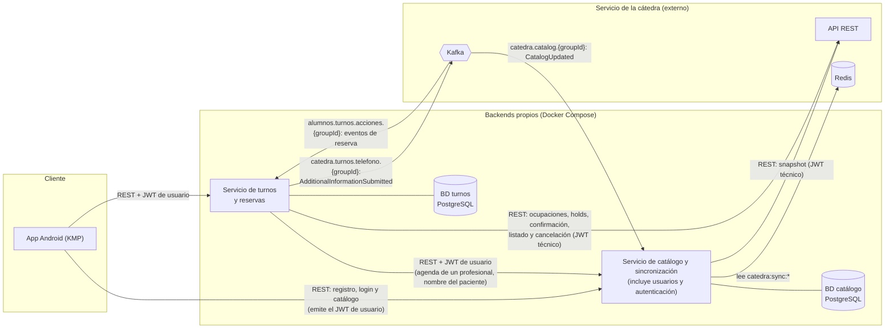
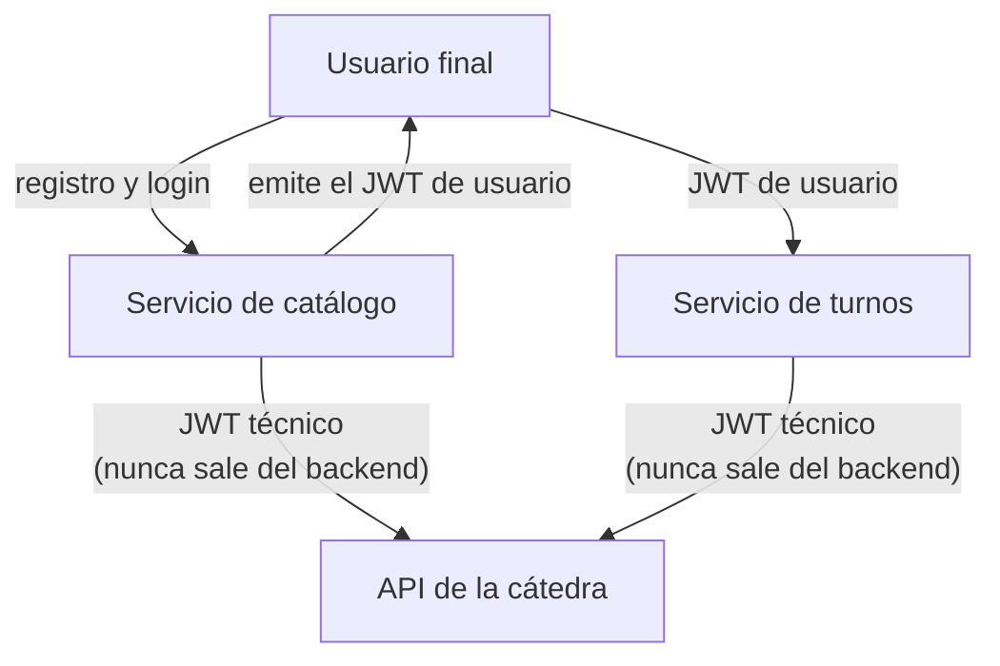
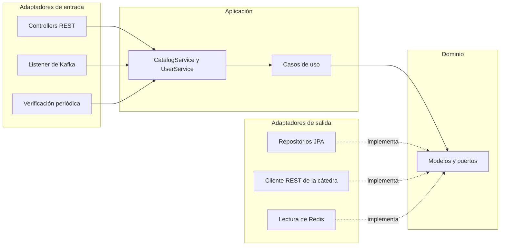

# Arquitectura

Este documento muestra el sistema completo (la aplicación Android, los dos servicios backend, sus bases de datos y las integraciones con la cátedra) y, después, cómo está organizado por dentro el servicio de catálogo. El diagrama general es el mismo en el repositorio de turnos.

## El sistema

El servicio de catálogo hace dos cosas: sincroniza el catálogo con la cátedra y atiende a los usuarios (registro, login y emisión del JWT).

### Reglas que respeta

- La aplicación Android nunca habla con la cátedra ni conoce el JWT técnico: todo pasa por los dos servicios.
- Cada servicio es dueño exclusivo de su base, con su propia instancia de PostgreSQL y sus propias migraciones ([decisión 002](decisiones/002-base-postgresql-propia-por-servicio.md)). No hay claves foráneas ni accesos cruzados entre las dos bases; ver [modelo-de-datos.md](modelo-de-datos.md).
- Turnos no replica el catálogo: le pide a catálogo la agenda de un profesional cuando la necesita ([contrato.md](contrato.md#lo-que-turnos-consume-de-catálogo)).
- Catálogo es el único que consume `CatalogUpdated` y el único que lee las claves `catedra:sync:*` de Redis.
- Turnos es el único que consume los eventos de reserva y el que publica el teléfono del paciente.
- Los dos servicios usan la misma cuenta técnica de la cátedra, cargada por la variable de entorno `CATEDRA_JWT`.

### Dos identidades, dos JWT

El JWT de usuario lo emite catálogo y lo valida turnos con el mismo secreto ([seguridad.md](seguridad.md)). El JWT técnico identifica a los dos servicios ante la cátedra y no viaja nunca a la aplicación.

## El servicio de catálogo por dentro

El servicio sigue la arquitectura hexagonal (puertos y adaptadores). Tiene dos slices, cada uno con sus capas `domain`, `application` e `infrastructure`:

- `catalogo`: la copia local del catálogo, la sincronización con la cátedra, la búsqueda y el estado de la sincronización.
- `usuario`: el registro, el login y la cuenta, y la emisión del JWT.

Además, `shared` agrupa lo que no pertenece a un slice: la configuración, la seguridad y el manejo de errores web.

- **Dominio** (`domain`): los modelos y los puertos de entrada (un caso de uso por interfaz) y de salida. No importa Spring.
- **Aplicación** (`application`): los casos de uso y un servicio por slice (`CatalogService`, `UserService`) que los expone a los adaptadores de entrada.
- **Adaptadores de entrada** (`infrastructure`): los controllers (`web`), `CatalogEventListener` (`kafka`) y `CatalogVersionCheckScheduler` (`scheduling`). Todos llaman a un servicio de la capa de aplicación (`CatalogService` o `UserService`) y ninguno contiene lógica de negocio.
- **Adaptadores de salida** (`infrastructure`): la persistencia JPA (`persistence`), `CatedraApiClientAdapter` (`client`) y `CatedraSyncSourceAdapter` (`redis`).

Las decisiones de cada pieza están en [decisiones/](decisiones/README.md): la autenticación como caso de uso propio ([014](decisiones/014-autenticacion-como-caso-de-uso.md)), el cliente REST ([019](decisiones/019-cliente-rest-de-la-catedra.md)), el cliente Redis ([021](decisiones/021-cliente-redis-de-solo-lectura.md)), el consumidor de Kafka ([023](decisiones/023-consumo-de-catalogupdated.md)) y la verificación de versión ([025](decisiones/025-verificacion-de-version.md)).

## Cómo se ejecuta

Cada repositorio trae su `docker-compose.yml` con su propia base y se levanta por separado ([decisión 004](decisiones/004-docker-compose-por-repositorio.md)). Los pasos están en el [README](../README.md).
