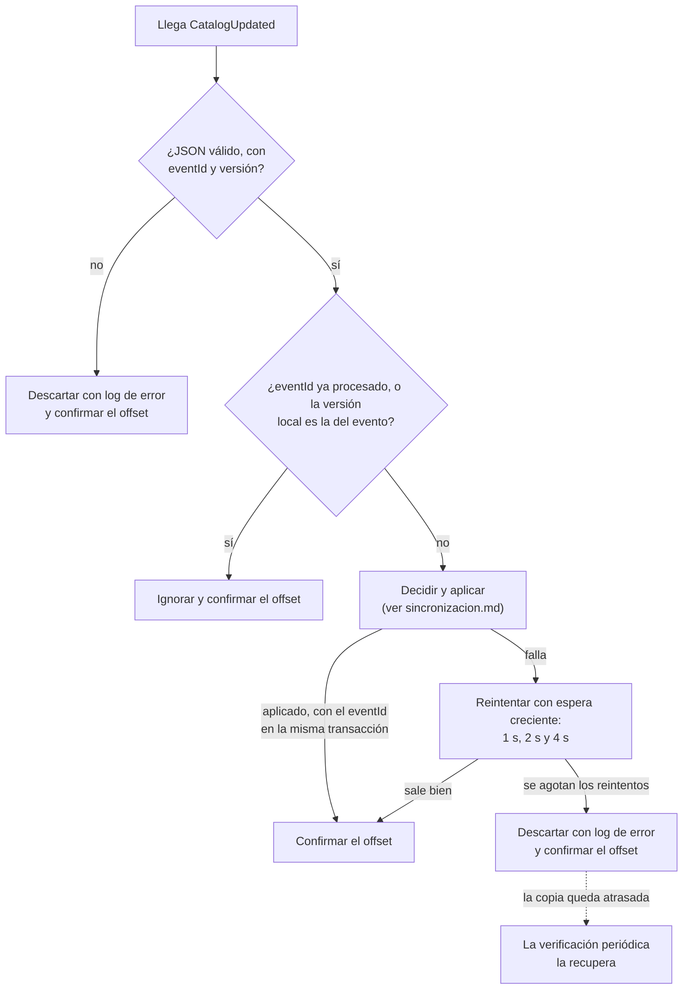

# Idempotencia y recuperación

Kafka entrega cada mensaje **al menos una vez**: `CatalogUpdated` puede llegar repetido, puede perderse y puede llegar después de un fallo del servicio. Este documento explica qué hace el servicio en cada caso y por qué la copia local termina siempre al día. La estrategia de sincronización en sí está en [sincronizacion.md](sincronizacion.md).

## Cuatro principios

1. **El evento solo dispara.** No trae datos. La versión que manda es la que Redis publica en el momento de procesarlo, así que un evento viejo o repetido no puede llevar la copia a un estado equivocado.
2. **Datos, versión y `eventId` cambian juntos o no cambian.** Se escriben en una sola transacción: no puede quedar un evento marcado como procesado sin que se hayan aplicado sus datos, ni al revés.
3. **El offset de Kafka se confirma al final**, después del `COMMIT` (`ack-mode=manual`). Si el servicio cae antes, Kafka reentrega el mensaje y el `eventId` evita repetir el efecto.
4. **Una sincronización a la vez**, con un candado en memoria y el bloqueo de la fila `sync_state` en la base.

## Qué pasa con un mensaje

Un mensaje que no se puede interpretar (JSON inválido, sin `eventId` o con una versión inválida) se descarta sin reintentar, porque repetirlo no lo arregla. Los reintentos son `CATEDRA_KAFKA_MAX_RETRIES` (3 por defecto) con espera inicial `CATEDRA_KAFKA_INITIAL_BACKOFF` (1 segundo), que se duplica en cada intento. Agotados, el mensaje se descarta y se sigue con el siguiente: reintentar sin límite o detener el consumo dejaría que un único mensaje que siempre falla bloquee a todos los demás ([decisión 023](decisiones/023-consumo-de-catalogupdated.md)).

## Mensajes duplicados

- **Antes de pedir nada**, el servicio descarta el evento si su `eventId` ya está en `processed_events` o si la versión local es justo la que anuncia: así un duplicado no cuesta un pedido HTTP ni una escritura.
- **Dentro de la transacción**, el `eventId` se comprueba otra vez y la clave primaria de `processed_events` rechaza al repetido. Eso cubre dos mensajes iguales que corren a la vez.
- **Si el servicio cae entre el `COMMIT` y la confirmación del offset**, Kafka reentrega el evento; ya figura procesado y no se repite nada.
- Un grupo sin offset guardado empieza por el principio del topic (`earliest`): los eventos viejos se descartan solos, porque la copia ya está al día o su `eventId` ya figura.

Reaplicar un snapshot ya es idempotente en el resultado (es un upsert), pero repetiría un pedido a la cátedra y una escritura por cada duplicado: la deduplicación evita ese costo.

## Mensajes perdidos

Un aviso se puede perder si se agotan los reintentos, si el servicio estuvo caído y el grupo ya había avanzado, o si la cátedra publicó una versión sin que llegara el aviso. Para eso existe la **verificación de versión**: el servicio compara su versión con la de Redis al arrancar y cada 5 minutos, sin esperar un evento, y aplica lo que falte, ya sea incremental o snapshot. Con la base vacía trae el snapshot por sí solo.

El atraso por un aviso perdido dura, como máximo, el intervalo de la verificación más lo que tarde en aplicarse. No hay cola de eventos muertos: no aportaría nada que la verificación periódica no resuelva ya, y sumaría otro topic y otro consumidor ([decisión 025](decisiones/025-verificacion-de-version.md)).

## Mensajes fuera de orden

- **Un evento viejo que llega tarde no hace nada**: la decisión usa la versión actual de Redis, no la del evento. Si la copia ya está en esa versión, no se aplica nada.
- **Las versiones se aplican en orden.** La incremental recorre desde `local + 1` y, con la fila de `sync_state` bloqueada, rechaza cualquier versión que no sea exactamente la siguiente. Si algo no encaja, la sincronización cae al snapshot.
- **Una versión local mayor que la de Redis** no se ignora: puede ser un retroceso de la cátedra, que es la fuente de verdad. Se aplica el snapshot, aunque su versión sea menor, y se deja un aviso en el log ([decisión 024](decisiones/024-sincronizacion-incremental.md)).
- **Dos disparadores a la vez** (un evento y la verificación periódica) no se cruzan: comparten el candado, y la segunda sincronización pide un snapshot ya fresco en vez de aplicar uno viejo.

## Fallos y recuperación del estado

- **Si una sincronización falla**, se guarda `last_status = ERROR` y el error en `sync_state`, en una transacción propia (la de los datos ya se deshizo), sin tocar la versión local. Si registrar el fallo también falla, se relanza la excepción original con la del registro como suprimida.
- **Cuando una vuelta posterior encuentra la copia al día**, el estado vuelve a `OK` y el error se borra, de modo que `GET /api/sync/status` nunca muestra un error viejo con la copia sana. Solo se escribe si había un error que limpiar.
- **Si la cátedra, Redis o Kafka no responden**, el servicio sigue sano y sirviendo la copia local: ninguno de los tres forma parte de `/actuator/health`.
- **Si la base está caída**, el error no puede registrarse y `sync_state` conserva el estado anterior hasta la próxima sincronización.

## Límites conocidos

- **Una sola instancia.** El candado en memoria vale para una instancia; con varias, el bloqueo de la fila `sync_state` evita que se pisen, pero no ahorra pedidos al snapshot.
- **`processed_events` no se depura**: guarda una fila por evento procesado y esas filas no se borran.
- **El formato de los datos.** Si la cátedra cambiara la forma de un dato y no solo su nombre, habría que tocar el código; las rutas y claves sí se cambian por configuración ([decisión 022](decisiones/022-rutas-y-claves-como-configuracion.md)).
