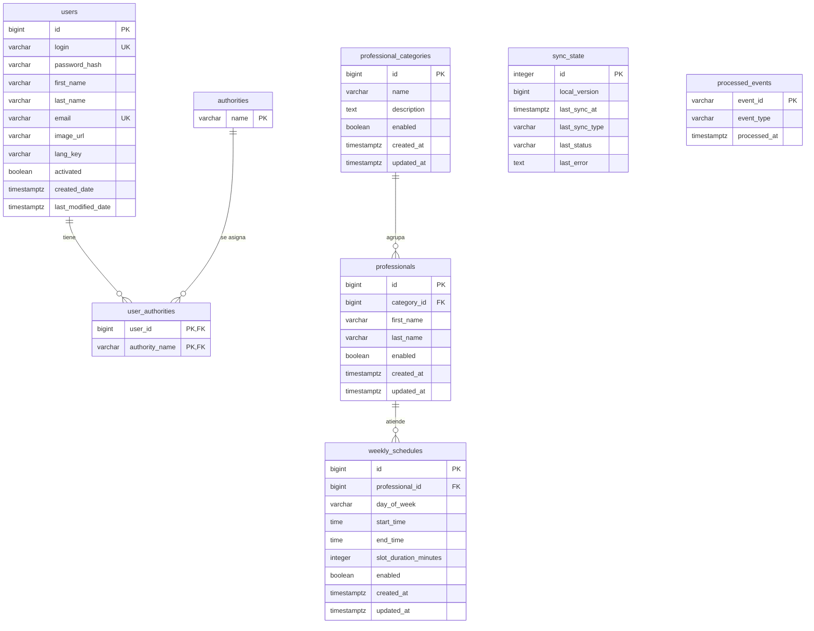

# Modelo de datos

El servicio de catálogo tiene su propia instancia de PostgreSQL 18, con su base y su usuario ([decisión 002](decisiones/002-base-postgresql-propia-por-servicio.md)). El esquema lo crean solo las migraciones de Flyway (`src/main/resources/db/migration`) y Hibernate corre con `ddl-auto=validate`, así que cualquier diferencia entre las entidades y las tablas impide arrancar ([decisión 003](decisiones/003-esquema-con-flyway.md)).

## Diagrama

`sync_state` y `processed_events` no tienen relaciones con el resto.

## Las tablas, por su origen

### Usuarios y credenciales

`users`, `authorities` y `user_authorities`. El modelo es el de JHipster, sin campos propios ([decisión 007](decisiones/007-usuarios-compatibles-con-jhipster.md)). Los escribe el registro y la actualización de la cuenta.

- `users.id` lo genera la base y no cambia nunca: es lo que viaja en el claim `uid` del JWT. Por eso el email se puede modificar.
- `login` y `email` son únicos, con restricciones con nombre (`uk_users_login` y `uk_users_email`): el manejo de errores las usa para distinguir cuál se repitió. Se guardan en minúsculas.
- `password_hash` guarda un hash Argon2id de unos 97 caracteres, en una columna de 255 ([decisión 008](decisiones/008-hash-de-contrasenas-argon2id.md)). La contraseña en claro no se guarda ni se registra.
- `authorities` tiene una fila, `ROLE_USER`, que crea la migración. Al borrar un usuario, sus filas de `user_authorities` se borran con él.

### Copia local del catálogo

`professional_categories`, `professionals` y `weekly_schedules`. Son una copia de lo que publica la cátedra ([decisión 018](decisiones/018-esquema-de-la-copia-local.md)).

- Los `id` son los de la cátedra y no se generan acá, para poder aplicar un cambio por id.
- La cátedra da las bajas de forma lógica y el servicio las guarda como `enabled = false`: en el funcionamiento normal no se borra ninguna fila. Solo la sincronización completa elimina filas, y únicamente las que la cátedra ya no envía en el snapshot (por ejemplo, si reinicia o purga sus datos).
- Claves foráneas normales, de profesional a categoría y de horario a profesional, con un índice en cada una.
- `day_of_week` admite solo los siete nombres de día en inglés; un horario exige `end_time > start_time` y `slot_duration_minutes > 0`.
- Los nombres y la descripción no tienen un largo documentado por la cátedra: se usan límites amplios (255 caracteres y `TEXT`).
- Lo único que escribe en estas tablas es la sincronización ([sincronizacion.md](sincronizacion.md)). El servicio no tiene ningún endpoint de escritura del catálogo.

### Control de la sincronización

- `sync_state` tiene una sola fila (`id = 1`, garantizado con un `CHECK`), creada por la migración. `local_version = 0` significa «base vacía, hace falta un snapshot». La versión cambia solo en la misma transacción que aplica los datos. `last_sync_type` admite `FULL` o `INCREMENTAL` y `last_status`, `OK` o `ERROR`.
- `processed_events` guarda el `eventId` de cada evento de Kafka ya aplicado. Su clave primaria rechaza un evento repetido ([idempotencia-y-recuperacion.md](idempotencia-y-recuperacion.md)).

## Propiedad de los datos

| Dato | Quién es el dueño | Qué hace este servicio |
|---|---|---|
| Usuarios, contraseñas y roles | Catálogo, y solo catálogo | Los crea, los guarda y emite el JWT |
| Categorías, profesionales y horarios | La cátedra (fuente de verdad) | Guarda una copia local y la mantiene al día; nunca la modifica por su cuenta |
| Estado de la sincronización y eventos procesados | Catálogo | Los escribe al sincronizar |
| Reservas y turnos | Turnos y la cátedra | No existen en esta base |

La delimitación con turnos es total:

- Los dos servicios tienen instancias de PostgreSQL distintas: ninguno lee ni escribe la base del otro, y no hay claves foráneas entre ellas.
- Turnos guarda el usuario (`user_id`, el `uid` del JWT) y el profesional (`professional_id`, el id de la cátedra) **por valor**, sin clave foránea.
- Lo que turnos necesita de catálogo lo pide por REST con el JWT del usuario: la agenda de un profesional y el nombre del paciente ([contrato.md](contrato.md#lo-que-turnos-consume-de-catálogo)).
- Las credenciales de los usuarios no salen de esta base: turnos nunca ve una contraseña ni un hash, solo valida el JWT.

## Migraciones

| Versión | Qué hace |
|---|---|
| `V1__crear_usuarios` | `users`, `authorities`, `user_authorities` y el rol `ROLE_USER` |
| `V2__crear_catalogo` | la copia del catálogo, `sync_state` (con su fila) y `processed_events` |
| `V3__ampliar_password_hash` | ensancha `users.password_hash` de 60 a 255 caracteres, porque un hash Argon2id mide unos 97 |
| `V4__habilitar_unaccent` | instala la extensión `unaccent`, que usa la búsqueda por nombre para ignorar tildes |

Una migración ya aplicada no se edita: un cambio de esquema es una migración nueva.
