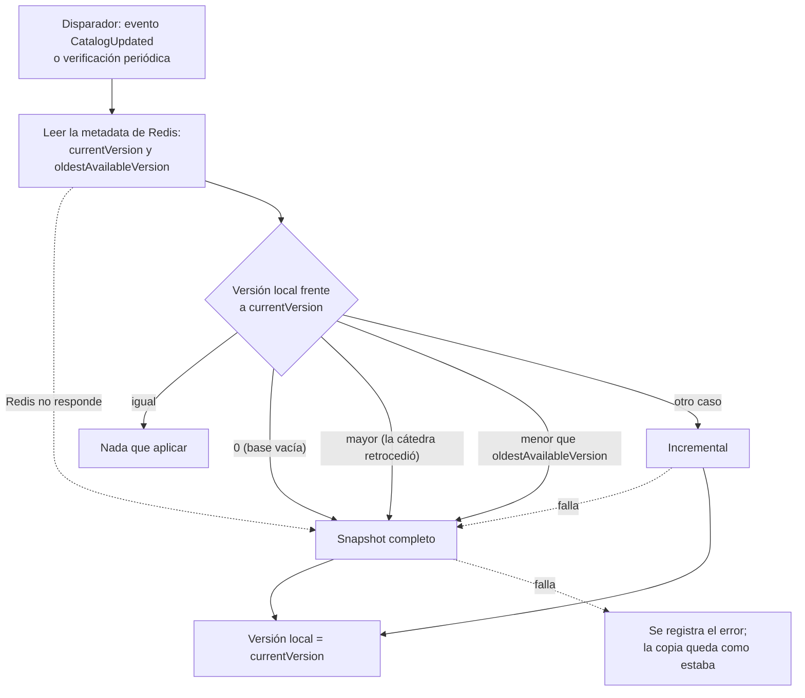
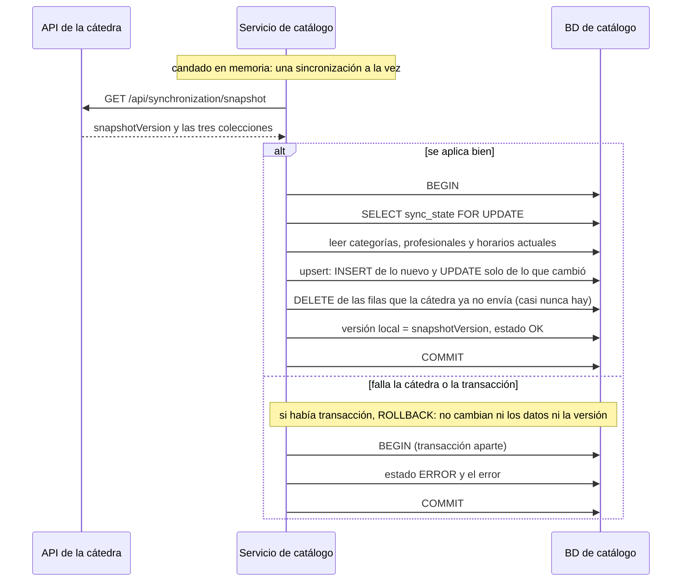
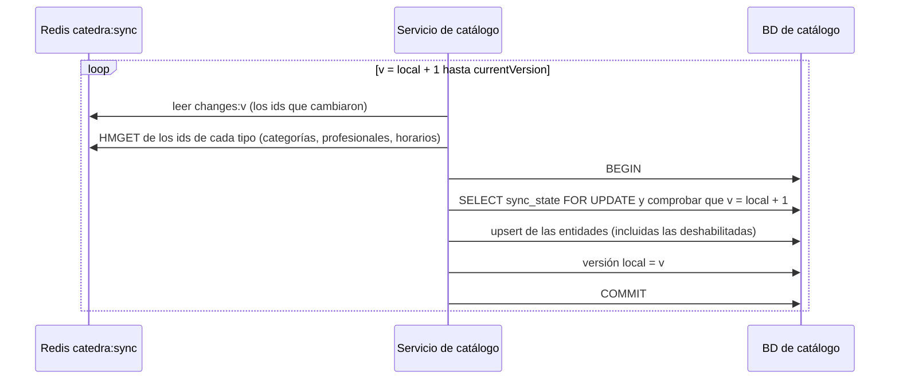

# Sincronización del catálogo

El servicio guarda una copia local del catálogo de la cátedra (categorías, profesionales y horarios semanales) y responde las búsquedas solo con ella: ningún pedido de un usuario llama a la cátedra. Este documento explica cómo se mantiene esa copia al día. Qué pasa cuando los mensajes se repiten, se pierden o llegan desordenados está en [idempotencia-y-recuperacion.md](idempotencia-y-recuperacion.md).

## Las tres fuentes de la cátedra

| Fuente | Qué aporta | Cómo se usa |
|---|---|---|
| Snapshot REST (`GET /api/synchronization/snapshot`, con el JWT técnico) | el catálogo completo y su versión | sincronización completa |
| Redis (solo lectura, `catedra:sync:*`) | la metadata con las versiones, los ids que cambiaron en cada versión y el estado vigente de cada entidad por id | decidir y hacer la sincronización incremental |
| Kafka (`CatalogUpdated`) | un aviso de que hay una versión nueva; **no trae datos** | disparar la sincronización |

La metadata de Redis trae `currentVersion` (la versión vigente) y `oldestAvailableVersion` (la más antigua de la que todavía se guardan los cambios). Se lee en una sola operación para que las dos cifras sean consistentes entre sí.

## Cuándo se sincroniza

| Disparador | Qué pasa |
|---|---|
| Un evento `CatalogUpdated` | se decide cómo sincronizar (ver abajo) |
| La verificación de versión, unos segundos después de arrancar y cada 5 minutos | la misma decisión, sin evento. Con la base vacía trae el snapshot, así que un servicio recién instalado se llena solo |

## La decisión: incremental o completa

El evento solo **dispara**: la versión que manda es la que Redis publica en ese momento. El servicio compara su versión local con la de Redis:

| Versión local | Qué hace |
|---|---|
| Igual a `currentVersion` | nada (copia al día; un evento viejo que llega tarde no cambia nada) |
| 0 (base vacía) | snapshot completo |
| Mayor que `currentVersion` | snapshot completo: la cátedra retrocedió y es la fuente de verdad. Se avisa con un log |
| Menor que `oldestAvailableVersion` | snapshot completo: ya no están todos los cambios necesarios |
| Cualquier otra menor | incremental, de a una versión, desde `local + 1` hasta `currentVersion` |

Estas reglas son una función pura del dominio, `SyncPlanner.plan(localVersion, metadata)`: no lee Redis ni la base y devuelve un `SyncPlan` (`UpToDate`, `Snapshot(reason)` o `Incremental(from, to)`), con el motivo del snapshot escrito en el propio plan. El caso de uso solo lee la metadata, se la pasa y ejecuta el plan, y por eso las reglas y sus bordes se prueban sin ningún mock (`SyncPlannerTest`).

Cualquier fallo de la incremental, o una lectura de Redis que no responde, cae al snapshot completo. El fallo de la incremental no se registra en el estado: solo si también falla el snapshot se registra este, y el de la incremental viaja como excepción suprimida.

## Sincronización completa (snapshot)

- **Upsert, no borrar todo.** Un *upsert* es «insertar si es nuevo, actualizar si ya existe». Se leen las tres tablas y se guarda cada elemento del snapshot: Hibernate emite `INSERT` para un id nuevo y `UPDATE` solo si algo cambió. Se escribe de padres a hijos y se borra de hijos a padres por las claves foráneas ([decisión 020](decisiones/020-sincronizacion-completa-por-upsert.md)).
- **Cuándo se borra algo.** La cátedra da las bajas de forma lógica (`enabled = false`), que llegan como un `UPDATE` más, así que en el funcionamiento normal el borrado no encuentra filas. Existe como defensa: si la cátedra reiniciara o purgara sus datos, lo que ya no existe allá tampoco quedaría acá. La incremental, en cambio, nunca borra: solo ve lo que cambió.
- **El pedido HTTP va antes de la transacción**, para no retener una conexión a la base mientras se espera a la cátedra.
- **Una sincronización a la vez.** Un candado en memoria envuelve todo, el pedido incluido: si dos disparadores coinciden, la segunda pide su propio snapshot cuando la primera termina y nunca aplica uno viejo encima de uno nuevo. El `SELECT ... FOR UPDATE` sobre `sync_state` serializa también a dos instancias del servicio.
- **Un snapshot con versión menor se aplica igual**: la cátedra es la fuente de verdad. El resultado trae la versión anterior y la nueva y quien lo dispara escribe el aviso.
- **Si algo falla no cambia nada**, ni los datos ni la versión. El error se registra en otra transacción, porque la de los datos ya se deshizo. Si la base está caída no hay dónde registrarlo y `sync_state` conserva el estado anterior.

## Sincronización incremental

- **Una transacción por versión**: si la cátedra falla a mitad, lo ya aplicado queda y la versión local avanza hasta donde llegó.
- **El orden se comprueba dentro de la transacción**: con la fila bloqueada, una versión que no sea exactamente `local + 1` se rechaza.
- **No se borra nada.** La incremental solo ve lo que cambió, no el catálogo entero; las bajas de la cátedra llegan como `enabled = false` y el snapshot limpia lo que ya no exista.
- **Cae al snapshot** si falta `changes:N` (esa versión ya salió de la ventana que la cátedra retiene), si una entidad que se pide ya no está en Redis, si un dato es inválido o si la base lo rechaza.
- **El `eventId` se guarda en la transacción de la última versión**, para que nunca figure como procesado un evento que no se terminó de aplicar.

Las decisiones detrás de este diseño están en la [024](decisiones/024-sincronizacion-incremental.md) y la [021](decisiones/021-cliente-redis-de-solo-lectura.md).

## Verificación de versión

Kafka solo avisa y el aviso puede perderse. Por eso el servicio compara su versión con la de Redis por su cuenta, sin esperar un evento:

- La primera vuelta ocurre `CATEDRA_SYNC_INITIAL_DELAY` después de arrancar (10 segundos por defecto) y después una cada `CATEDRA_SYNC_CHECK_INTERVAL` (5 minutos por defecto), contadas desde el **fin** de la anterior, para que nunca se solapen.
- Aplica la misma decisión de arriba. Si la copia está al día, es una sola lectura a Redis y no toca la base.
- Si una vuelta falla (la cátedra o Redis caídos), se registra el error y se reintenta en la siguiente; el servicio sigue sano y sirviendo la copia local. Ni Redis ni Kafka forman parte de `/actuator/health`, porque un servicio ajeno caído no debe volver «no saludable» a este.
- **Recuperación del estado:** si una vuelta falló y la siguiente encuentra la copia al día, `sync_state` vuelve a `OK` y se borra el error. Describe cómo está la copia ahora, no el último tropiezo.

Los valores de ajuste tienen un valor por defecto en `application.properties` y, si la variable de entorno está definida, esa gana. Se validan al arrancar: el intervalo debe ser mayor que cero y la espera inicial no puede ser negativa ([decisión 025](decisiones/025-verificacion-de-version.md)).

## Cómo se ve el estado

`GET /api/sync/status` informa la versión local y el resultado del último intento (ver [contrato.md](contrato.md#get-apisyncstatus)). Los errores se guardan sin datos sensibles: de una falla al hablar con la cátedra se guarda la clase y el mensaje, que escribimos nosotros; de cualquier otra excepción, solo el nombre de la clase ([decisión 026](decisiones/026-estado-de-la-sincronizacion.md)). El detalle completo queda en el log. Las reglas de qué queda escrito en cada caso (un éxito deja la versión, la fecha, el tipo y el estado `OK` y borra el error; un fallo no cambia la versión; limpiar un error no cambia ni la versión ni el tipo) viven en `SyncState`, con `recordSuccess`, `recordFailure` y `clearError`: los casos de uso las llaman y no pueden saltearlas, porque `SyncState` no tiene setters.
